# CloudCart on AWS EKS

A production-style Amazon EKS platform built with Terraform (49 folders, one state each), running a small real application (**CloudCart**) so you can learn,
build, break, troubleshoot and explain how EKS integrates with the AWS ecosystem.

> Nothing here is applied automatically. You run every `terraform apply` yourself, one folder at a time (`scripts/tf.sh`), after reviewing the plan.

## Architecture



(Service blocks are labelled and coloured by AWS category; they are not the official AWS icon set, which is not bundled in this repository.)

## What is this project? Why are we building it?
A complete EKS platform from an empty repository: VPC, EKS, IAM, Pod Identity/IRSA, ECR, storage, databases, messaging, load balancing, DNS/TLS, WAF/CloudFront,
Karpenter, observability, security services, backup and CI/CD. Knowing Kubernetes is not the same as knowing how EKS connects to IAM, VPC, ECR, RDS, S3, SQS and the load balancers.

## What are we learning?
Terraform dependency chains and remote state; identity (IAM, STS, Pod Identity, IRSA, access entries); VPC CNI networking; storage (EBS/EFS/S3); data stores; event-driven design;
ALB/NLB/Gateway API; scaling (HPA, Karpenter, Spot, Fargate); observability; security layers; DR; cost; troubleshooting; interviews.

## What AWS services are involved?
VPC, endpoints, EKS, EC2, Fargate, IAM, STS, KMS, ECR, S3, DynamoDB, RDS, ElastiCache, SQS, SNS, EventBridge, Lambda, Secrets Manager, Systems Manager Parameter Store,
Route 53, ACM, CloudFront, WAF, ALB/NLB, VPC Lattice, CloudWatch, Container Insights, CloudTrail, GuardDuty, Security Hub, Config, Backup, EFS/EBS, Budgets.

## What does CloudCart do?
`frontend` (nginx static UI) -> `product-service` (FastAPI: DynamoDB catalog, S3 images, Redis cache) and `order-service` (FastAPI: PostgreSQL orders, publishes to SQS) ->
`worker` (SQS consumer: updates the order, publishes `OrderProcessed` to EventBridge) -> Lambda -> SNS -> subscribers. Source: `application/`.

## How does traffic flow?
```
Users -> Route 53 -> CloudFront -> WAF -> ALB (public subnets) -> target group (pod IPs) -> frontend -> product-service / order-service -> AWS services
```

## How does authentication work?
People/CI: IAM (STS) -> EKS access entries -> Kubernetes RBAC. Pods: ServiceAccount -> **EKS Pod Identity** -> IAM role -> temporary STS credentials (IRSA is demonstrated and used on Fargate).
No access keys exist anywhere. See `docs/identity/workload-identity.md`.

## How does EKS communicate with AWS services?
Pods use temporary credentials and reach AWS over private paths: S3/DynamoDB gateway endpoints, interface endpoints (ECR, STS, SSM, Secrets Manager, SQS, Events) or NAT.
Databases live in isolated subnets and accept only the node/pod security groups. See `docs/networking/eks-networking.md`.

## How does Terraform work? How are folders connected? Where is state?
Each `terraform/NN-name/` is an independent root module with its own state: `s3://cloudcart-tfstate-<account>-<region>/<environment>/<folder>/terraform.tfstate`
(versioned, encrypted, native locking; created by `00-bootstrap` on local state to solve the chicken-and-egg). Later folders read earlier outputs through `terraform_remote_state`;
no ID is ever copied by hand. Apply order: `scripts/execution-order.txt` (the folder number equals the apply order except **16-kms**, applied right after 03).
`scripts/tf.sh` verifies upstream state exists before every plan/apply; `scripts/check-wiring.py` statically verifies every cross-folder output. Each folder README lists inputs, outputs and consumers.

## How are Docker images built and pushed? How does EKS pull them?
`scripts/build-push.sh`: docker build (multi-stage, non-root, pinned deps, healthcheck) -> local image store -> tag `vX.Y.Z-<gitsha>` -> scan -> `aws ecr get-login-password | docker login` -> `docker push`.
ECR repositories are IMMUTABLE (a tag can never change). Nodes pull with the **node role** (kubelet), not the pod's identity; layers come from S3, so private subnets need the S3 endpoint.
`latest` is refused by the Helm chart and scripts.

## How are secrets handled?
No Kubernetes Secrets. Passwords/tokens live in Secrets Manager (KMS-encrypted) and are read by pods at runtime with Pod Identity; endpoints live in SSM Parameter Store. See `kubernetes/secrets/README.md`.

## How is the application exposed? How does scaling work?
Ingress -> AWS Load Balancer Controller -> ALB (+WAF, ACM TLS, optional CloudFront/Route 53); an NLB example shows layer 4 with static IPs. HPA scales pods, Karpenter scales nodes (Spot for the worker), metrics-server feeds the HPA.

## How do we troubleshoot?
Method: SYMPTOM -> HYPOTHESIS -> DIAGNOSTIC COMMANDS -> EVIDENCE -> ROOT CAUSE -> FIX -> PREVENTION. 17 playbooks in `docs/troubleshooting/playbooks.md`; 51 hands-on tests (including controlled failures) in `USER_GUIDE.txt`.

## How do we clean everything up?
`scripts/destroy-all.sh` (reverse dependency order; first removes what Kubernetes created outside Terraform: ALBs, EBS volumes, Karpenter nodes). `scripts/cost-check.sh` lists anything still billing.

## Repository layout
```
application/   services (frontend, product-service, order-service, worker) + lambda
architecture/  cloudcart-architecture.svg
docs/          architecture, networking, security, identity, storage, databases, messaging, scaling, observability,
               troubleshooting, disaster-recovery, cost, deployment, interviews, decisions (ADRs)
envs/          per-environment tfvars (lab; add dev/stage/prod)
helm/cloudcart Helm chart for the application
kubernetes/    namespaces, serviceaccounts, config, secrets (none), frontend, product-service, order-service, worker,
               ingress, network-policies, storage, autoscaling, karpenter, rbac, fargate, prefix-delegation, security-groups-for-pods
scripts/       tf.sh, verify.sh, env.sh, build-push.sh, deploy-app.sh, deploy-karpenter.sh, render-k8s.sh, destroy-all.sh, cost-check.sh, check-wiring.py, validate-all.sh
terraform/     00-bootstrap ... 47-gitops, 99-capstone
USER_GUIDE.txt hands-on test manual (35 sections)
```

## Terraform vs Kubernetes
Terraform: anything with an AWS lifecycle or IAM blast radius (VPC, EKS, IAM, data stores, controllers, add-ons). kubectl/Helm/GitOps: application workloads, scheduling policy (NodePools), network policies for the app.

## Cost warning
EKS control plane (~$73/mo), NAT gateway, ALB/NLB, RDS, ElastiCache and interface endpoints cost real money. Set a budget (`envs/lab/00-bootstrap.tfvars`), destroy after each session, run `scripts/cost-check.sh`. See `docs/cost/cost.md`.

## Where to start
1. `docs/architecture/overview.md` 2. `terraform/00-bootstrap/README.md` 3. follow `scripts/execution-order.txt` with `scripts/tf.sh` 4. `USER_GUIDE.txt`.
