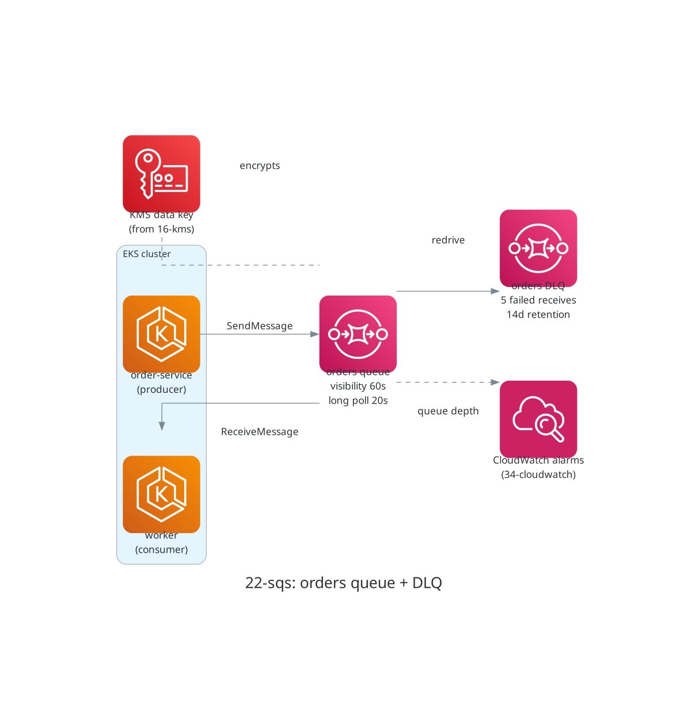

# 22-sqs — The Order Waiting Room (Queue + Dead-Letter Queue)

> **One-liner:** This folder creates the SQS queue where orders wait to be processed, plus a "dead-letter" queue where broken orders go so they never block or crash the system.

## In plain English (the layman story)

Imagine a busy pizza shop. When the cashier takes an order, they don't run to the kitchen and cook it themselves — they pin a ticket on a rail. Cooks grab tickets from the rail when they're free. If a ticket is unreadable (say, ketchup spilled on it) and 5 cooks each try and fail to make it, the manager moves it to a special "problem tickets" box instead of letting it jam the rail forever.

- **The ticket rail** = the `orders` SQS queue (created here).
- **The cashier** = `order-service` (pins tickets: `SendMessage`).
- **The cooks** = `worker` pods (grab tickets: `ReceiveMessage`).
- **The problem-tickets box** = the DLQ (dead-letter queue), created here too.
- **The lock on the rail** = the KMS key from `16-kms` that encrypts every ticket.

Without this folder, `order-service` would have to call the worker directly and wait — if the worker is slow or down, customers get errors. With a queue, the API answers instantly and the work happens a moment later. This is called **decoupling**, and it's one of the most-tested ideas in interviews.

## What actually happens, step by step (who does what)

1. **You** run `scripts/tf.sh 22-sqs apply`. Terraform reads the IAM role names from `08-pod-identity`'s state and the KMS key ARN from `16-kms`'s state (via `terraform_remote_state` — nothing is copy-pasted).
2. **Terraform** creates two queues in AWS: `orders` and `orders-dlq`, both encrypted with the KMS key.
3. **Terraform** wires them together with a *redrive policy*: if a message is received 5 times and never deleted, SQS itself moves it to the DLQ.
4. **Terraform** writes two IAM policies: the order-service role may *only send*, the worker role may *only receive/delete*. Least privilege — neither can do the other's job.
5. **Terraform** stores the queue URL in SSM Parameter Store so the Helm chart can hand it to the pods.
6. Later, at runtime: a customer places an order → `order-service` pod sends a message → a `worker` pod long-polls (waits up to 20s for a message, so it's not hammering the API) → processes it → deletes the message. If processing takes longer than the 60-second *visibility timeout*, the message reappears and may be processed twice — which is why handlers must be **idempotent**.

## Key resources created

| Resource | What it is | Why it exists |
|---|---|---|
| `orders` queue | Main SQS queue | Buffers orders between API and worker |
| `orders-dlq` | Dead-letter queue | Isolates "poison" messages after 5 failures (14-day retention) |
| Redrive policy | JSON rule on the main queue | Automatic moving of failed messages — no manual babysitting |
| Producer IAM policy | Allows `sqs:SendMessage` | order-service can send, nothing else |
| Consumer IAM policy | Allows `sqs:ReceiveMessage/DeleteMessage` + `kms:Decrypt` | worker can read and clean up |
| SSM parameter | Queue URL | Pods discover the queue without hardcoding |

## Wiring: who feeds this folder, who eats from it

- **Reads from:** `08-pod-identity` (IAM role names), `16-kms` (encryption key ARN).
- **Feeds:** `34-cloudwatch` (alarms on queue names), scripts/Helm values (queue URL/ARN).
- **State:** its own state file at `s3://cloudcart-tfstate-.../22-sqs/terraform.tfstate`.

## Why this folder exists (and what breaks without it)

Traffic spikes happen (flash sales!). The queue absorbs them: 1 order/second or 1,000/second, the API stays fast and workers catch up at their own pace. Without it you'd need synchronous calls, retries in the app code, and you'd lose orders whenever the worker restarts. Also note the security story: no passwords, no access keys — the pods assume IAM roles (Pod Identity) and every message is encrypted with KMS.

## Interview corner

**30-second answer:** "SQS decouples our API from order processing. The order-service drops a message and returns immediately; workers long-poll and process at their own pace. The visibility timeout gives a worker 60 seconds to finish; after 5 failed attempts the redrive policy parks the message in a DLQ for investigation. Delivery is at-least-once, so handlers are idempotent. Everything is KMS-encrypted and accessed via least-privilege IAM roles through EKS Pod Identity."

**Likely questions:**
- *SQS vs SNS vs EventBridge?* SQS = one consumer pulls (queue). SNS = many subscribers pushed (topic). EventBridge = event router with filtering and many targets.
- *What is the visibility timeout?* How long a fetched message stays invisible to other workers; if the worker doesn't delete it in time, it reappears.
- *How do you handle poison messages?* Redrive policy → DLQ → alarm on DLQ depth → inspect with `aws sqs receive-message` on the DLQ.
- *Standard vs FIFO?* Standard = unlimited throughput, at-least-once, best-effort order. FIFO = strict order, exactly-once, 300 msg/s (3,000 with batching).

**Gotchas to mention:** long polling cuts cost and empty responses; DLQ alarms are a production must; scale workers on queue depth (KEDA) for real elasticity.

## Diagram

*Real AWS icons: orange = EKS compute, pink = messaging/security services. Solid arrows = message flow, dashed = encryption/telemetry.*

---

📎 **Source folder:** [terraform/22-sqs/](../../terraform/22-sqs/README.md) · **Apply:** `scripts/tf.sh 22-sqs plan` then `apply` · **Destroy:** never before `34-cloudwatch` and the app are gone.
