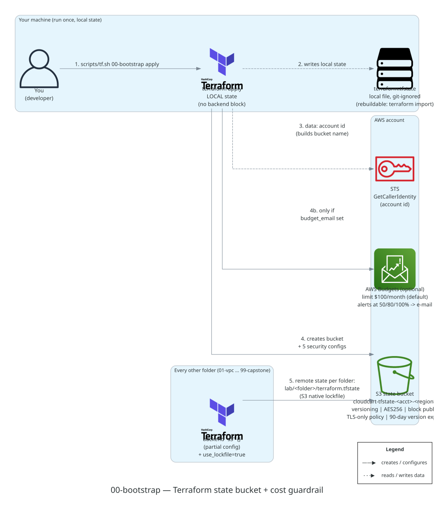

# 00-bootstrap — Terraform state bucket + cost guardrail

## 1. Purpose
This folder creates the one thing every other CloudCart folder needs before it can run: a **versioned, encrypted S3 bucket that stores all Terraform remote state**, plus an optional AWS Budget that e-mails you before a forgotten lab costs real money. It is the only folder that keeps its own state **locally** — the bucket cannot store the state file that creates the bucket itself (the chicken-and-egg problem).

## 2. Architecture Diagram

Numbered arrows show the sequence; solid arrows create/configure, dashed arrows read/write data. There is **no runtime traffic** here — this folder only provisions and configures.

## 3. Files Explained
| File | What it does | Why it exists |
|---|---|---|
| `versions.tf` | Pins Terraform >= 1.11 and AWS provider ~> 6.0. **No backend block, on purpose.** | This folder creates the backend, so it must run on local state first. |
| `providers.tf` | AWS provider on the CLI credential chain; adds cost-allocation `default_tags`. | No credentials in code; everything is tagged for billing. |
| `variables.tf` | `project`, `environment`, `region`, `owner`, `budget_email`, `monthly_budget_usd` (default 100). | One place to rename the project or set the alert e-mail. |
| `main.tf` | The S3 state bucket + 5 security/lifecycle configs, and an optional `aws_budgets_budget`. | The actual infrastructure; every resource carries a WHY comment. |
| `outputs.tf` | Exports `state_bucket` name and the state key pattern. | Read by humans/scripts; folders do not read it via remote state (circular). |
| `terraform.tfstate` | This folder's own state: a local, git-ignored file. | Rebuildable with `terraform import aws_s3_bucket.state <bucket>` if lost. |
| `diagrams/` | `architecture.svg` + the Python script that regenerates it. | The picture above. |

## 4. How It Works
1. `source scripts/env.sh` calls **STS GetCallerIdentity** and computes the bucket name deterministically: `cloudcart-tfstate-<account-id>-<region>`.
2. `scripts/tf.sh 00-bootstrap apply` runs plain `terraform apply` (local state — this is the only folder that gets no `-backend-config`) and makes you type the folder name as a safety check.
3. Terraform creates **one S3 bucket** with five protections: **versioning** (recover from a bad apply), **SSE-S3 AES256** (state files contain secrets), **public access fully blocked**, a **bucket policy denying non-TLS traffic**, and a **lifecycle rule** expiring state versions older than 90 days. A `prevent_destroy` lifecycle rule blocks accidental deletion.
4. If `budget_email` is set, it also creates a **monthly cost budget** (default $100) e-mailing at 50% and 80% actual spend and 100% forecast. Budgets data lags up to ~24h — a safety net, not a kill switch.
5. Every later folder (`01-vpc` … `99-capstone`) declares an empty `backend "s3" {}` and `tf.sh` injects bucket/key/region plus `use_lockfile=true`, storing state at `s3://<bucket>/lab/<folder>/terraform.tfstate`. Locking uses S3 native lockfiles (Terraform >= 1.11) — no DynamoDB table.

## 5. Dependencies and Outputs
- **Needs first:** valid AWS credentials only (`aws sso login` or `AWS_PROFILE`). No other folder, no pre-existing resources.
- **Creates:** the state bucket (with versioning, encryption, public-access block, TLS-only policy, lifecycle) and, optionally, one budget.
- **Consumed by:** every other folder, via its S3 backend and `terraform_remote_state` reads. They learn the bucket name from `scripts/env.sh` (same deterministic formula), not from remote state — that would be circular.
- **Verified from code:** all of the above (`main.tf`, `outputs.tf`, `scripts/env.sh`, `scripts/tf.sh`, the generated `versions.tf` in other folders).
- **Uncertain:** a local `terraform.tfstate` and `tfplan` exist, suggesting bootstrap was already applied once; not verified against the live AWS account.

## 6. How to Verify
Safe, read-only checks (`scripts/verify.sh 00-bootstrap` runs them for you):

| Command | Success means |
|---|---|
| `aws s3api head-bucket --bucket <name>` | bucket exists and is yours (404 = not created, 403 = someone else's) |
| `aws s3api get-bucket-versioning --bucket <name>` | `Enabled` — every state write is recoverable |
| `aws s3api get-bucket-encryption --bucket <name>` | `AES256` encryption configured |
| `aws s3api get-public-access-block --bucket <name>` | four `true` values — can never go public |

A clean `scripts/tf.sh 00-bootstrap plan` shows `6 to add` (7 with a budget) on a fresh account, or `No changes` if already applied.

## 7. Common Failure
- **`BucketAlreadyExists`** — the name embeds your account id, so this usually means *you* created it earlier. Confirm with `head-bucket`; if it is yours, `terraform import aws_s3_bucket.state <name>` and re-plan.
- **`InvalidClientTokenId` / `ExpiredToken`** — expired credentials. Confirm with `aws sts get-caller-identity`, then `aws sso login` or fix `AWS_PROFILE`.
- **Later folders fail with `NoSuchBucket`** — bootstrap was never applied, or was applied in a different region than `AWS_REGION` in `scripts/env.sh`.

**Cleanup warning (destructive):** destroying this bucket deletes **all Terraform state for every folder** — the infrastructure becomes unmanaged. Do it last, after every other folder is destroyed, removing `prevent_destroy` deliberately and emptying all object versions first.

## 8. Interview Answer
**30-second answer:** "Every folder in the project stores its Terraform state in one versioned, encrypted S3 bucket with native S3 locking — one state object per folder to limit blast radius. The bucket can't store the state that creates it, so a small bootstrap stack runs once on local state — the classic chicken-and-egg solution. The bucket name is deterministic (project, account id, region), so scripts compute it directly instead of a circular remote-state lookup. The same stack adds a budget alert, because the project spins up NAT gateways and EKS and a forgotten lab costs real money."

**Likely follow-up — "What if two people apply at once?"** The S3 backend uses native lockfiles (`use_lockfile=true`, Terraform >= 1.11): each state object gets a `<key>.tflock` object written with an S3 conditional write, so the second apply fails fast instead of corrupting state. This replaced the older DynamoDB lock table. And if state is corrupted anyway, bucket versioning lets you roll back to a previous object version (kept 90 days).

*Lab vs production: SSE-S3 -> dedicated KMS CMK restricted to the CI role · your admin identity -> per-folder IAM · one account -> state in a tooling account with cross-region replication.*
