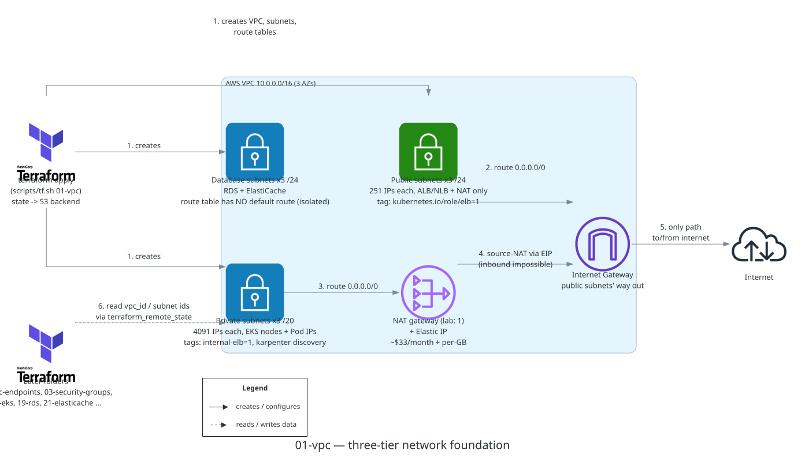

# 01-vpc — three-tier network foundation

## 1. Purpose
This folder builds the VPC that every other CloudCart folder runs inside: a dedicated `10.0.0.0/16` network spanning three Availability Zones, split into public, private, and isolated database tiers. CloudCart needs it because EKS, RDS, and ElastiCache all demand controlled routing — the default VPC gives no isolation guarantees. It is the first folder that stores its state in the bootstrap S3 backend.

## 2. Architecture Diagram

Numbered arrows show the provisioning sequence; solid arrows create/configure, dashed arrows read/write data. There is **no runtime traffic here** — this folder only provisions the network; pod and app traffic comes later.

## 3. Files Explained
| File | What it does | Why it exists |
|---|---|---|
| `main.tf` | VPC + emptied default SG, IGW, 3 subnet tiers per AZ, EIP + NAT gateway(s), 5 route tables + associations. | The actual network; every resource carries a WHY/GOES-WRONG comment. |
| `variables.tf` | `vpc_cidr` (default `10.0.0.0/16`, must be /18 or larger), `az_count` (2-3, default 3), `single_nat_gateway` (default `true`). | Lab vs production switches in one place. |
| `outputs.tf` | Exports vpc id/cidr, all subnet id lists, route table ids, AZs, NAT public IPs. | Later folders wire themselves in via `terraform_remote_state`. |
| `common.tf` | Shared `project`/`environment`/`region`/`owner`/`state_bucket` variables + naming/tag locals (generated from `_common`). | Identical conventions in every folder. |
| `versions.tf` / `providers.tf` | Terraform >= 1.11, AWS provider ~> 6.0, empty `backend "s3" {}`, default cost tags. | `scripts/tf.sh` injects bucket/key/region + `use_lockfile=true`. |
| `diagrams/` | `architecture.svg` + the Python script that regenerates it. | The picture above. |

## 4. How It Works
1. `data.aws_availability_zones` picks the first `az_count` (default **3**) AZs that need no opt-in; a local map gives each AZ a stable index so plans never reshuffle subnets.
2. Terraform creates the **VPC** (`10.0.0.0/16`) with DNS support **and** DNS hostnames enabled — both required for EKS node registration and VPC endpoint private DNS. The **default security group is emptied** (tagged `DO-NOT-USE`) so anything accidentally launched into it is unreachable.
3. **Three subnet tiers per AZ**, carved deterministically: public `10.0.0.0/24`-`10.0.2.0/24` (251 IPs each, load balancers + NAT only, `map_public_ip_on_launch = false`), private `10.0.16.0/20`-`10.0.48.0/20` (**4091 IPs each** — the VPC CNI gives every Pod a real VPC IP, so a /24 would exhaust fast), database `10.0.100.0/24`-`10.0.102.0/24` (251 each, RDS/ElastiCache).
4. Subnets get **discovery tags**: `kubernetes.io/role/elb=1` on public, `kubernetes.io/role/internal-elb=1` + `karpenter.sh/discovery` on private — this is how the AWS Load Balancer Controller and Karpenter find subnets at runtime.
5. **Routing**: one public route table with `0.0.0.0/0 -> IGW`; one private route table **per AZ** with `0.0.0.0/0 -> NAT`; the database route table has **no default route at all** — that absence *is* the isolation.
6. **NAT**: lab default `single_nat_gateway = true` creates one NAT + one Elastic IP in the first AZ (~$33/month + per-GB charges). Production sets it `false` for one NAT per AZ, so an AZ outage doesn't kill egress elsewhere.
7. State lands at `s3://<state-bucket>/lab/01-vpc/terraform.tfstate` (injected by `tf.sh`); NACLs are deliberately left at the default allow-all — security groups are the primary control.

## 5. Dependencies and Outputs
- **Needs first:** `00-bootstrap` (state backend) and AWS credentials. No other folder.
- **Creates:** 1 VPC, emptied default SG, 1 IGW, 9 subnets (3 tiers x 3 AZs), 1-3 EIPs + NAT gateways, 5 route tables, 9 associations.
- **Consumed by:** `02-vpc-endpoints` (`vpc_id`, `vpc_cidr`, `private_subnet_ids`, `private_route_table_ids`), `03-security-groups` (`vpc_id`), `06-eks` (`private_subnet_ids`), `19-rds` + `21-elasticache` (`database_subnet_ids`), `28-load-balancer-controller`, `30-nlb` (`azs`, `public_subnet_ids`), `31-vpc-lattice` (`vpc_id`) — all via `terraform_remote_state`.
- **Verified from code:** every consumer above read directly from their `data.tf`; tag consumers (Karpenter, LB controller) verified in `main.tf` comments and `scripts/verify.sh`.
- **Uncertain:** the old README claimed `13-ebs` consumes `private_subnet_ids` for EFS mount targets — EFS mounts actually live in `14-efs`; `13-ebs` reads a `dep` remote-state map not yet traced to this folder.

## 6. How to Verify
`scripts/verify.sh 01-vpc` supports this folder (read-only). Key checks:

| Command | Success means |
|---|---|
| `aws ec2 describe-vpcs --vpc-ids <id>` | state `available` |
| `aws ec2 describe-vpc-attribute --attribute enableDnsSupport` (+ `enableDnsHostnames`) | both `True` |
| `aws ec2 describe-subnets --filters Name=tag:Tier,Values=private` | >= 2 subnets per tier |
| `aws ec2 describe-nat-gateways --filter Name=vpc-id,...` | state `available` (`failed` is terminal) |
| `aws ec2 describe-route-tables --route-table-ids <db-rt>` | **zero** routes to `0.0.0.0/0` = isolation proven |

## 7. Common Failure
- **`AddressLimitExceeded`** — the default Elastic IP quota is 5 per region; the NAT EIP fails to allocate. Check `aws ec2 describe-addresses`, release unused EIPs or request a quota increase.
- **Nodes can't pull images later** — the private route table lost its NAT route or the NAT never became `available`. Inspect `describe-route-tables` for a `0.0.0.0/0 -> nat-*` entry and poll the NAT state.
- **LB Controller "couldn't auto-discover subnets" (seen in 28/29)** — missing `kubernetes.io/role/elb` tags, usually from out-of-band changes; a `plan` here should show tag drift.

## 8. Interview Answer
**30-second answer:** "I built a three-tier VPC across three AZs in Terraform: small public /24s for load balancers and NAT, large private /20s for EKS nodes and pods — big because the VPC CNI assigns every pod a real VPC IP — and database subnets whose route table deliberately has no default route, which is isolation by design, not by security group. Subnets carry the `kubernetes.io/role/elb` and Karpenter discovery tags so controllers find them. The lab runs one shared NAT to save cost; production would run one per AZ."

**Likely follow-up — "What happens when a private subnet runs out of IPs?"** Pods fail to start because the VPC CNI can't allocate ENI IPs (you'll see IPAM errors on the node). Mitigations: big subnets up front (why /20 here), prefix delegation, secondary CIDR custom networking, or IPv6.

*Lab vs production: one shared NAT -> NAT per AZ · default allow-all NACLs -> custom NACLs on the database tier · flow logs off -> on, to S3/CloudWatch.*
