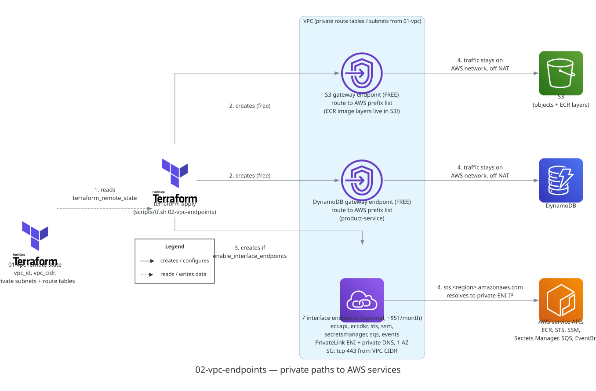

# 02-vpc-endpoints — private paths to AWS services

## 1. Purpose
This folder gives everything in the private subnets a way to reach AWS APIs **without going through the NAT gateway**: free gateway endpoints for S3 and DynamoDB, plus seven optional PrivateLink interface endpoints (ECR, STS, SSM, Secrets Manager, SQS, EventBridge). CloudCart needs it because NAT data processing costs $0.045/GB and image pulls + SDK calls would otherwise all pay that toll.

## 2. Architecture Diagram

Numbered arrows show the provisioning sequence; solid arrows create/configure, dashed arrows read/write data. Endpoints change **routing and DNS**, not app code — runtime traffic simply stops crossing the NAT.

## 3. Files Explained
| File | What it does | Why it exists |
|---|---|---|
| `data.tf` | Reads `01-vpc` remote state: `vpc_id`, `vpc_cidr`, `private_subnet_ids`, `private_route_table_ids`. | Endpoints must attach to the existing VPC. |
| `main.tf` | Endpoint security group (443 from VPC CIDR), 2 gateway endpoints, `for_each` interface endpoints. | The actual endpoints; comments explain the ECR-needs-3-endpoints trap. |
| `variables.tf` | `enable_interface_endpoints` (default `true`), the 7-service list, `interface_endpoint_az_count` (default 1). | Cost switches: interface endpoints bill per AZ-hour. |
| `outputs.tf` | `vpce_security_group_id`, `gateway_endpoint_ids`, `interface_endpoint_ids`. | For verification and docs — endpoints work transparently via DNS. |
| `common.tf` / `versions.tf` / `providers.tf` | Shared variables, pins, empty S3 backend, default tags (generated from `_common`). | Same conventions as every folder. |

## 4. How It Works
1. **Reads `01-vpc` state** to learn the VPC and its private route tables/subnets; `tf.sh` refuses to run if that state is missing.
2. Creates a **security group** for interface endpoints allowing tcp/443 from the whole VPC CIDR (`create_before_destroy` so updates never leave a gap). Without this, SDK calls hang until timeout while S3 still works — the classic symptom.
3. **Gateway endpoints (free)**: S3 and DynamoDB become prefix-list routes in the **private** route tables. S3 matters extra because **ECR image layers live in S3** — a private image pull needs `ecr.api` + `ecr.dkr` interface endpoints *and* the S3 gateway endpoint.
4. **Interface endpoints (billed)**: for each of the 7 services an ENI is placed in `interface_endpoint_az_count` (default **1**) AZs — about $7.3/month per endpoint per AZ, so ~$51/month for the lab set. `private_dns_enabled = true` makes e.g. `sts.us-east-1.amazonaws.com` resolve to the private ENI IP inside the VPC.
5. Everything else (public image registries, third-party APIs) still egresses through the NAT gateway from `01-vpc`.
6. Set `enable_interface_endpoints = false` and the folder creates only the free gateway endpoints — all AWS API traffic falls back to NAT.

## 5. Dependencies and Outputs
- **Needs first:** `01-vpc` (reads 4 outputs via `terraform_remote_state`).
- **Creates:** 1 security group + 1 ingress rule, 2 gateway endpoints (S3, DynamoDB), 0-7 interface endpoints.
- **Consumed by:** **no later folder** reads these outputs — endpoints are transparent once private DNS resolves; only `scripts/verify.sh` reads `interface_endpoint_ids`.
- **Verified from code:** inputs (`data.tf`), resources and costs (`main.tf`, `variables.tf`), verify script (`scripts/verify.sh`).
- **Uncertain:** none — the absence of downstream remote-state consumers was confirmed by searching every `data.tf`.

## 6. How to Verify
`scripts/verify.sh 02-vpc-endpoints` supports this folder (read-only, polls until `available`):

| Command | Success means |
|---|---|
| `aws ec2 describe-vpc-endpoints --filters Name=service-name,Values=com.amazonaws.<region>.s3` | gateway endpoint exists, state `available` (same for dynamodb) |
| `aws ec2 describe-vpc-endpoints --vpc-endpoint-ids <id>` | interface endpoint state `available` (`failed`/`rejected` is terminal) |
| `... --query 'VpcEndpoints[0].PrivateDnsEnabled'` | `True` — else you pay for endpoints but traffic still uses NAT |

Once EKS exists, `nslookup sts.<region>.amazonaws.com` from a pod must return a private `10.0.x.x` address.

## 7. Common Failure
- **SDK calls to STS/SSM hang, S3 works** — the endpoint SG lost its 443 ingress. Check `aws ec2 describe-security-groups --group-ids <vpce-sg>`; S3 works because it uses the free gateway route, not an ENI.
- **`ImagePullBackOff` in private subnets** — one of the three ECR paths is missing; usually the S3 gateway endpoint isn't attached to the **private** route tables. `describe-vpc-endpoints` + check route table ids.
- **Endpoint creation fails with a DNS error** — VPC DNS support/hostnames disabled; both are enabled in `01-vpc`, so this means drift or a hand-made VPC.

## 8. Interview Answer
**30-second answer:** "VPC endpoints keep AWS API traffic off the NAT gateway. Gateway endpoints for S3 and DynamoDB are free — just a prefix-list route in the private route tables. Interface endpoints are PrivateLink ENIs with private DNS, billed about $7 per endpoint per AZ per month, so the lab enables seven of them in a single AZ. The subtle part: an ECR image pull needs three endpoints — ecr.api, ecr.dkr, and the S3 gateway endpoint, because image layers are stored in S3."

**Likely follow-up — "Gateway vs interface endpoint?"** Gateway endpoints (S3, DynamoDB only) are route-table entries to an AWS prefix list — free, no ENI. Interface endpoints work for most other services: an ENI with a private IP in your subnet plus private DNS so the public hostname resolves privately — billed hourly per AZ and per GB.

*Lab vs production: endpoint ENIs in 1 AZ -> all AZs (HA, no cross-AZ charges) · no endpoint policy -> policies restricting to your account/resources (anti-exfiltration).*
