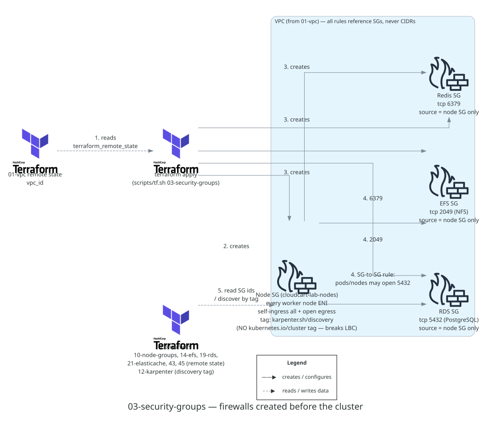

# 03-security-groups — firewalls created before the cluster

## 1. Purpose
This folder creates four VPC security groups — one for EKS worker nodes and one each for RDS, Redis, and EFS — **before the EKS cluster exists**. CloudCart needs its own node SG because the EKS-created cluster SG only appears in `06-eks`, and data-tier rules must reference a stable source SG that survives cluster rebuilds. Security groups are free.

## 2. Architecture Diagram

Numbered arrows show the provisioning sequence; solid arrows create/configure, dashed arrows read/write data. SGs are pure provisioning — runtime effect is that data-tier ports accept traffic **only** from the node SG.

## 3. Files Explained
| File | What it does | Why it exists |
|---|---|---|
| `data.tf` | Reads `01-vpc` remote state (`vpc_id`); pins ports as locals: 5432, 6379, 2049. | SGs must live in the VPC; ports in one place. |
| `main.tf` | 4 security groups + 4 rules (nodes self-ingress, nodes egress, 3 SG-to-SG ingress rules). | The firewalls; every rule carries a WHY/GOES-WRONG comment. |
| `outputs.tf` | `node_security_group_id`, `rds_security_group_id`, `redis_security_group_id`, `efs_security_group_id`. | Node groups, Karpenter, and the data tier attach these. |
| `common.tf` / `versions.tf` / `providers.tf` | Shared variables, pins, empty S3 backend, default tags (generated from `_common`). | Same conventions as every folder. |

## 4. How It Works
1. Reads `vpc_id` from `01-vpc` remote state; `tf.sh` refuses to run if that state is missing.
2. Creates the **node SG** (`cloudcart-lab-nodes`) with `name_prefix` + `create_before_destroy` (rules can be replaced without a gap), tagged `karpenter.sh/discovery` so Karpenter finds it — and deliberately **not** tagged `kubernetes.io/cluster/<name>`, because a second cluster-tagged SG on a node ENI breaks the AWS Load Balancer Controller.
3. Node rules: **self-referencing ingress** (all protocols from itself — kubelet, CoreDNS, pod-to-pod across nodes) and **open egress** to `0.0.0.0/0` (SGs are stateful, so replies flow back automatically).
4. Creates **rds / redis / efs** SGs, each with exactly one ingress rule whose *source is the node SG*, never a CIDR: tcp **5432** (PostgreSQL), tcp **6379** (Redis/Valkey), tcp **2049** (NFS — mounted by the node kernel, so the source really is the node).
5. Why SG references, not CIDRs: the source follows instances automatically, survives pod/node IP churn, and can't be matched by an unrelated host that happens to share a subnet. Because pods share the node ENI (VPC CNI), "from node-sg" means "from any pod on those nodes" — `43-security-groups-for-pods` narrows that later.

## 5. Dependencies and Outputs
- **Needs first:** `01-vpc` (`vpc_id` via `terraform_remote_state`).
- **Creates:** 4 security groups, 4 rules (1 self-ingress, 1 egress, 3 SG-to-SG ingress).
- **Consumed by:** `10-node-groups` + `45-prefix-delegation` (`node_security_group_id`), `19-rds` + `43-security-groups-for-pods` (`rds_security_group_id`), `21-elasticache` (`redis_security_group_id`), `14-efs` (`efs_security_group_id`) — all via `terraform_remote_state`; `12-karpenter` finds the node SG by its **discovery tag** instead.
- **Verified from code:** every consumer above read from their `data.tf`/`main.tf`.
- **Uncertain:** none — all four outputs have at least one verified consumer.

## 6. How to Verify
`scripts/verify.sh 03-security-groups` supports this folder (checks the four SGs by Name tag). Manual checks:

| Command | Success means |
|---|---|
| `aws ec2 describe-security-groups --filters Name=tag:Name,Values=cloudcart-lab-nodes` | `sg-*` returned (same for `-rds`, `-redis`, `-efs`) |
| `aws ec2 describe-security-group-rules --filters Name=group-id,Values=<rds-sg>` | exactly one ingress: tcp 5432, source = node SG id |

## 7. Common Failure
- **Pod-to-RDS times out (not "refused")** — SGs *drop* silently. Check the rule source is the node SG and that the pod's node actually carries it (`aws ec2 describe-instances` → SecurityGroups); a pod with its own SG (folder 43) bypasses node-sg rules.
- **Cross-node pod traffic fails while same-node works** — the self-referencing ingress rule was removed; CoreDNS and pod-to-pod die first, a confusing partial failure.
- **LB controller "multiple security groups tagged"** — someone added `kubernetes.io/cluster/<name>` to the node SG out-of-band; remove the tag, re-plan.

## 8. Interview Answer
**30-second answer:** "I create the security groups before the EKS cluster: one node SG plus one per data service, and every data-tier rule references the node SG as its source instead of CIDRs — so rules follow workloads as pod and node IPs churn, and an unrelated host in the same subnet can never match. The node SG exists separately from the EKS cluster SG so the data tier survives cluster rebuilds, and Karpenter discovers it via a tag. SGs are stateful ENI-level firewalls; they stack with NetworkPolicy and IAM rather than replacing either."

**Likely follow-up — "Why does a blocked security group look like a timeout, not a refusal?"** SGs silently DROP packets — no RST or ICMP error comes back — so the client just waits for its connect timeout. That's why the first check for "connection timed out" to RDS/Redis/EFS is the SG rule, whereas "connection refused" means the packet arrived and nothing listened.

*Lab vs production: one shared node SG -> per-tier node SGs · open egress -> restricted egress · node-wide source SG -> Security Groups for Pods per workload.*
