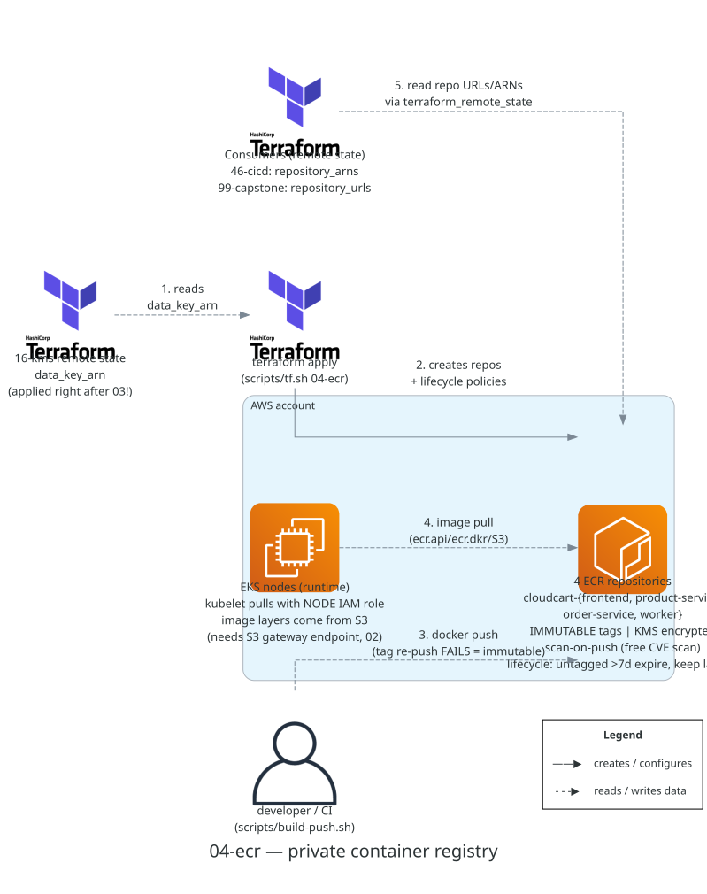

# 04-ecr — private container registry

## 1. Purpose
This folder creates CloudCart's private container registry: **one ECR repository per service** (frontend, product-service, order-service, worker) with immutable tags, KMS encryption, scan-on-push, and lifecycle rules. CloudCart needs it so EKS nodes pull exact, CVE-scanned image bytes from inside the AWS network instead of trusting mutable `:latest` tags from a public registry.

## 2. Architecture Diagram

Numbered arrows show the provisioning sequence; solid arrows create/configure, dashed arrows read/write data. Runtime pulls are done by the **kubelet with the node IAM role** — Pod Identity/IRSA are not involved in image pulls.

## 3. Files Explained
| File | What it does | Why it exists |
|---|---|---|
| `data.tf` | Reads `16-kms` remote state (`data_key_arn`). | Images are encrypted at rest with the shared data CMK. |
| `main.tf` | `aws_ecr_repository` per service + `aws_ecr_lifecycle_policy` per repo. | The registry itself; header comments list all four ImagePullBackOff causes. |
| `variables.tf` | `services` (4 defaults), `force_delete` (lab `true`), `keep_last_images` (30). | Repo list and lab/prod safety switches. |
| `outputs.tf` | `repository_urls`, `repository_arns`, `registry_url`. | CI and the capstone wire image references from these. |
| `common.tf` / `versions.tf` / `providers.tf` | Shared variables, pins, empty S3 backend, default tags (generated from `_common`). | Same conventions as every folder. |

## 4. How It Works
1. **Reads the KMS data key** from `16-kms` remote state — note the apply-order quirk: `16-kms` is applied *right after* `03-security-groups`, before this folder, despite its number. `tf.sh` checks that upstream state exists.
2. Creates **4 repositories** named `cloudcart-<service>` with three protections each: **`IMMUTABLE` tags** (tag `v1.0.1` can never be overwritten, so every node runs the same bytes and rollback is possible), **`scan_on_push`** (free basic CVE scan on every push), and **KMS encryption** with the data CMK.
3. Attaches a **lifecycle policy** to each repo: expire *untagged* images after **7 days**, and keep only the most recent **30 tagged** images (`imageCountMoreThan 30`). Without this, ECR grows forever at $0.10/GB-month.
4. `force_delete = true` (lab) lets `terraform destroy` remove repos that still contain images; production sets it `false` so a destroy fails loudly instead of deleting image history.
5. Runtime pull path (provisioned elsewhere, explained here): kubelet on the node authenticates to ECR with the **node IAM role** (registry read-only permissions attached in `10-node-groups`); image **layers come from S3 behind ECR**, which is why private subnets need the S3 gateway endpoint from `02-vpc-endpoints`.

## 5. Dependencies and Outputs
- **Needs first:** `16-kms` (`data_key_arn` via `terraform_remote_state`) and `00-bootstrap` (backend).
- **Creates:** 4 ECR repositories + 4 lifecycle policies.
- **Consumed by:** `46-cicd` (`repository_arns` — scopes the CI push role) and `99-capstone` (`repository_urls`, `registry_url` — a validation asserts exactly 4 repos), both via `terraform_remote_state`; `scripts/verify.sh 04-ecr` reads repo attributes directly from AWS.
- **Verified from code:** upstream read (`data.tf`), both consumers (`46-cicd/data.tf`, `99-capstone/data.tf` + `main.tf` validation).
- **Uncertain:** none for consumers. The old README's architecture note said pulls use the node role "from 05-iam"; the registry-read policy is actually attached in `10-node-groups` per `main.tf` comments.

## 6. How to Verify
`scripts/verify.sh 04-ecr` supports this folder (read-only):

| Command | Success means |
|---|---|
| `aws ecr describe-repositories` | 4 `cloudcart-*` repos with `IMMUTABLE` tags and `scanOnPush=true` |
| `aws ecr describe-images --repository-name cloudcart-frontend` | pushed images listed (after `scripts/build-push.sh`) |
| re-push the same tag | must **fail** — proof immutability works |

## 7. Common Failure
- **`ImagePullBackOff: no basic auth credentials`** — node role lacks ECR read permissions, or the image URL has the wrong account/region. `kubectl describe pod` shows the exact error; check `10-node-groups` role attachments.
- **`ImagePullBackOff: i/o timeout`** — no route to `ecr.api`/`ecr.dkr`/S3; check the `02-vpc-endpoints` interface endpoints and that the S3 **gateway** endpoint is on the private route tables.
- **`tag invalid: already exists` on push** — immutability working as designed; bump the tag. And `apply` failing with KMS `AccessDenied` means `16-kms` wasn't applied first.

## 8. Interview Answer
**30-second answer:** "CloudCart uses ECR as its private registry — one repo per service with immutable tags, so a deployment naming v1.0.1 is guaranteed the same bytes on every node and rollbacks are real; mutable latest tags can't offer that. Every push gets a free CVE scan, images are encrypted with our KMS key, and lifecycle rules expire untagged images after 7 days and keep the last 30 tagged. The subtle part: kubelets pull with the node IAM role, and image layers come from S3, so private subnets need the S3 gateway endpoint."

**Likely follow-up — "Who authenticates an ECR pull — the pod or the node?"** The **node**: the kubelet exchanges the node IAM role's credentials for an ECR auth token (via `ecr:GetAuthorizationToken`) and pulls. Pod Identity/IRSA play no part in image pulls — they govern what AWS APIs the *container* may call after it starts.

*Lab vs production: basic scanning -> enhanced scanning (Inspector) · force_delete=true -> false · single region -> pull-through cache + cross-region replication + repo policies/signing.*
