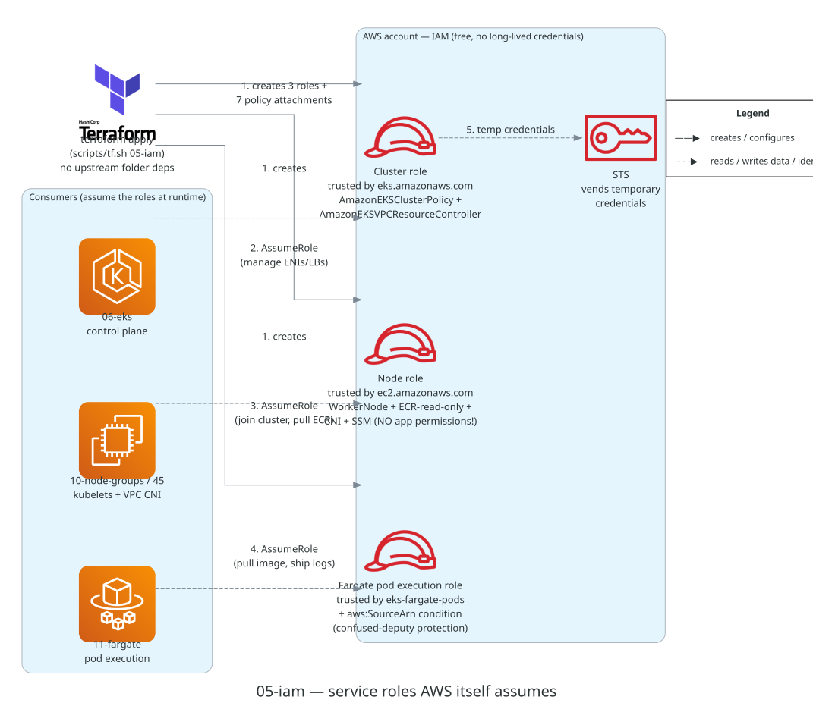

# 05-iam — service roles AWS itself assumes

## 1. Purpose
This folder creates the three **service roles** that AWS services assume to run CloudCart: the EKS control-plane role, the managed-node role, and the Fargate pod execution role. They live in their own folder because identities change rarely, are security-reviewed in one place, and should never be recreated just because a cluster is rebuilt. IAM is free; no long-lived credentials (IAM users) exist anywhere in this project.

## 2. Architecture Diagram

Numbered arrows show the provisioning sequence; solid arrows create/configure, dashed arrows read data/identity. These roles are only *assumed at runtime* — this folder itself provisions and has no traffic.

## 3. Files Explained
| File | What it does | Why it exists |
|---|---|---|
| `main.tf` | 3 `aws_iam_role` + assume-role policy documents + managed-policy attachments (7 total). | The identities; header comments define the project's 3 identity kinds. |
| `outputs.tf` | `cluster_role_arn`/`_name`, `node_role_arn`/`_name`, `fargate_role_arn`. | EKS, node groups, and Fargate profiles reference roles by ARN. |
| `common.tf` / `versions.tf` / `providers.tf` | Shared variables, pins, empty S3 backend, default tags (generated from `_common`). | Same conventions as every folder. |

## 4. How It Works
1. **Cluster role** (`cloudcart-lab-eks-cluster`): trust policy lets `eks.amazonaws.com` call `sts:AssumeRole`; managed policies **AmazonEKSClusterPolicy** + **AmazonEKSVPCResourceController** (the latter manages trunk ENIs for Security Groups for Pods, folder 43). The control plane uses it to create/attach cross-account ENIs and manage load balancers in *your* account.
2. **Node role** (`cloudcart-lab-eks-node`): trusted by `ec2.amazonaws.com`, attached to every managed-node-group instance profile. Four managed policies: **AmazonEKSWorkerNodePolicy** (kubelet bootstrap), **AmazonEC2ContainerRegistryReadOnly** (this *is* how EKS pulls images), **AmazonEKS_CNI_Policy** (VPC CNI manages ENIs/secondary IPs), **AmazonSSMManagedInstanceCore** (shell via Session Manager — no SSH keys, no bastion).
3. **Fargate pod execution role** (`cloudcart-lab-eks-fargate`): trusted by `eks-fargate-pods.amazonaws.com` **with an `aws:SourceArn` condition** limited to Fargate profiles of this cluster (confused-deputy protection); **AmazonEKSFargatePodExecutionRolePolicy** lets Fargate pull images and ship logs.
4. The node role deliberately gets **no application permissions** (no S3/DynamoDB): every pod shares the node's identity, so app rights would leak to all pods — that is exactly what Pod Identity (`08`) and IRSA (`09`) exist for.
5. Keep the three identity kinds straight: **service roles** (this folder, trusted by AWS services), **workload roles** (pods, 08/09), **human/CI roles** (07, 46). A role = identity + permissions; STS hands out the temporary credentials when it's assumed.

## 5. Dependencies and Outputs
- **Needs first:** only `00-bootstrap` (state backend). No other folder's outputs.
- **Creates:** 3 IAM roles + 7 managed-policy attachments.
- **Consumed by:** `06-eks` (`cluster_role_arn`, `cluster_role_name` — the name is used for the KMS inline policy), `10-node-groups` + `45-prefix-delegation` (`node_role_arn`), `11-fargate` (`fargate_role_arn`) — all via `terraform_remote_state`. `node_role_name` has no Terraform consumer (humans/scripts only).
- **Verified from code:** every consumer read from their `data.tf`.
- **Uncertain:** none.

## 6. How to Verify
`scripts/verify.sh` has no verifier for this folder yet — use these read-only commands:

| Command | Success means |
|---|---|
| `aws iam get-role --role-name cloudcart-lab-eks-cluster` | trust principal is `eks.amazonaws.com` |
| `aws iam list-attached-role-policies --role-name cloudcart-lab-eks-node` | the 4 managed policies listed |
| `aws iam get-role --role-name cloudcart-lab-eks-fargate --query Role.AssumeRolePolicyDocument` | `aws:SourceArn` condition present |

## 7. Common Failure
- **Cluster creation fails "role cannot be assumed"** — typo'd trust policy or the role was recreated after the cluster; compare with `aws iam get-role` output above.
- **Nodes NotReady / `ImagePullBackOff "no basic auth credentials"`** — a managed policy detached from the node role (worker policy → never Ready; ECR read-only → pull failures). `list-attached-role-policies` shows the gap.
- **Fargate pods stuck Pending** — pod execution role missing or its `SourceArn` condition doesn't match this cluster's Fargate profile ARN.

## 8. Interview Answer
**30-second answer:** "This folder creates the three service roles AWS assumes: the EKS cluster role so the control plane can manage ENIs and load balancers in my account, the node role — worker, CNI, ECR-read-only and SSM policies — which is how kubelets join the cluster and pull images, and the Fargate execution role with a SourceArn condition against confused-deputy abuse. Application permissions deliberately never go on the node role, because every pod on a node shares its identity — that's what Pod Identity and IRSA are for. No IAM users or long-lived keys anywhere; STS vends temporary credentials when a role is assumed."

**Likely follow-up — "IAM user vs role vs STS?"** A user has long-lived access keys (never used here). A role is an identity with a trust policy and permissions but no credentials of its own; when a trusted principal assumes it, **STS** issues short-lived credentials (AssumeRole for services, AssumeRoleWithWebIdentity for pods via OIDC). Least privilege + automatic rotation for free.

*Lab vs production: AWS managed policies suffice for service roles in both; production adds permission boundaries and SCPs — and still never puts app permissions on the node role.*
