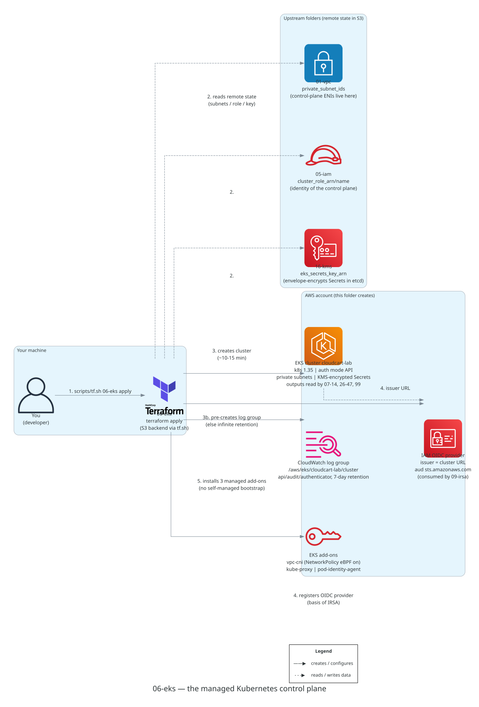

# 06-eks — the managed Kubernetes control plane

## 1. Purpose
This folder creates the heart of CloudCart: the **EKS cluster** — a managed, multi-AZ Kubernetes API server + etcd that AWS runs, while we own the worker nodes. It also creates the **OIDC provider** that makes IRSA possible (09-irsa), a **CloudWatch log group** for control-plane logs, and the three **EKS add-ons** that must exist before any node joins (VPC CNI, kube-proxy, Pod Identity Agent). Every later folder — nodes, storage, apps, ingress — reads this folder's state.

## 2. Architecture Diagram

Solid arrows provision; dashed arrows read data (remote state, issuer URL). Nodes join later (10-node-groups) — there is **no runtime traffic** in this folder.

## 3. Files Explained
| File | What it does | Why it exists |
|---|---|---|
| `versions.tf` / `providers.tf` | Standard pins (TF >= 1.11, AWS ~> 6.0), empty `backend "s3" {}` injected by `scripts/tf.sh`, cost-allocation tags. | Same boilerplate as every folder; state lands at `lab/06-eks/terraform.tfstate`. |
| `common.tf` | Shared naming/tags: cluster name = `cloudcart-lab`. | Generated from `_common`; two environments can never collide. |
| `data.tf` | Reads remote state of `01-vpc`, `05-iam`, `16-kms`. | Imports `private_subnet_ids`, `cluster_role_arn/name`, `eks_secrets_key_arn`. |
| `variables.tf` | `kubernetes_version` (default 1.35), endpoint exposure, log types, VPC CNI toggles, `ip_family`. | One place to choose version and lab-vs-prod endpoint posture. |
| `main.tf` | The cluster, KMS permission for the cluster role, log group, OIDC provider, 3 add-ons, Karpenter discovery tag. | Every resource carries WHY/DEPENDS/GOES-WRONG comments. |
| `outputs.tf` | Exports name, ARN, endpoint, CA, version, cluster SG id, OIDC provider ARN + issuer. | Read by ~20 downstream folders via remote state. |
| `diagrams/` | `architecture.svg` + the Python script that regenerates it. | The picture above. |

## 4. How It Works
1. `scripts/tf.sh 06-eks apply` injects the S3 backend config, and Terraform reads the state of `01-vpc` (private subnets), `05-iam` (cluster role) and `16-kms` (Secrets encryption key).
2. An **inline IAM policy** is attached to the cluster role allowing `kms:Encrypt/Decrypt/ListGrants/DescribeKey` on the one EKS secrets key — required for envelope encryption of Kubernetes Secrets in etcd. Without it, cluster creation fails with a KMS authorization error.
3. A **CloudWatch log group** `/aws/eks/cloudcart-lab/cluster` is pre-created with 7-day retention; otherwise EKS creates it with infinite retention (a silent cost). Enabled log types: `api`, `audit`, `authenticator`.
4. The **cluster** is created: Kubernetes **1.35** (default), `authentication_mode = "API"` (access entries replace the old aws-auth ConfigMap), `bootstrap_self_managed_addons = false` (we install add-ons as managed EKS add-ons so Terraform owns their versions), cross-account control-plane ENIs in the **private subnets only**, public endpoint enabled for the lab (`0.0.0.0/0` — restrict in production), Secrets envelope-encrypted with the KMS key, upgrade policy `STANDARD` (extended support costs ~6x). Creation takes **10-15 minutes** — do not interrupt.
5. The **OIDC provider** is registered in IAM (`client_id = sts.amazonaws.com`) so ServiceAccount JWTs can be exchanged for IAM credentials — the basis of IRSA (09-irsa).
6. Three **add-ons** are installed: `vpc-cni` (gives every Pod a real VPC IP; NetworkPolicy eBPF agent ON by default, prefix delegation and Pod ENI OFF by default), `kube-proxy` (iptables rules for Service IPs), `eks-pod-identity-agent` (DaemonSet answering credential requests at `169.254.170.23` — required by 08-pod-identity).
7. Finally, the EKS-created cluster security group is tagged `karpenter.sh/discovery = cloudcart-lab` so 12-karpenter can find it. Cost: **$0.10/hour (~$73/month)** even with zero nodes.

## 5. Dependencies and Outputs
- **Needs first:** `01-vpc` (`private_subnet_ids`), `05-iam` (`cluster_role_arn`, `cluster_role_name`), `16-kms` (`eks_secrets_key_arn`) — all read via `terraform_remote_state` in `data.tf`.
- **Creates:** the EKS cluster, the OIDC provider, the control-plane log group, an inline KMS policy on the 05-iam cluster role, three add-ons, and one EC2 tag on the cluster SG.
- **Consumed by:** `cluster_name`/endpoint/CA by `_common_k8s` and folders `07`–`14`, `26`, `28`, `34`, `35`, `41`–`47`, `99` (verified remote-state reads); `cluster_security_group_id` by `10-node-groups`, `43-security-groups-for-pods`, `45-prefix-delegation`; `oidc_provider_arn` + `oidc_issuer` by `09-irsa`.
- **Verified from code:** all reads above (`data.tf` files of the named folders) and every output in `outputs.tf`.
- **Uncertain:** whether the cluster is currently applied in the AWS account (not checked, per safety rules).

## 6. How to Verify
Safe, read-only checks (`scripts/verify.sh 06-eks` runs them, polling until ACTIVE):

| Command | Success means |
|---|---|
| `aws eks describe-cluster --name cloudcart-lab --query 'cluster.[status,version,accessConfig.authenticationMode]'` | `ACTIVE`, expected version, `API` |
| `aws eks list-addons --cluster-name cloudcart-lab` | `vpc-cni`, `kube-proxy`, `eks-pod-identity-agent` listed |
| `aws eks describe-addon --cluster-name cloudcart-lab --addon-name vpc-cni --query addon.status` | `ACTIVE` |
| `aws eks update-kubeconfig --name cloudcart-lab` then `kubectl get --raw /readyz` | `ok` — API reachable and you are authenticated |

## 7. Common Failure
- **Creation fails: "KMS key is not authorized"** — the cluster role lacks permission on the Secrets key. Confirm the inline policy exists (`aws iam get-role-policy --role-name <cluster-role> eks-secrets-kms`) and that the key policy in 16-kms delegates to IAM.
- **`kubectl` says "You must be logged in (Unauthorized)"** — authentication (IAM) worked but there is no access entry for your principal. The Terraform creator gets admin automatically (`bootstrap_cluster_creator_admin_permissions`); everyone else needs 07-eks-access. Compare `aws sts get-caller-identity` with `aws eks list-access-entries`.
- **`kubectl` times out** — the public endpoint CIDRs do not include your IP, or the endpoint was made private. Check `public_access_cidrs` and your current IP (`curl -s ifconfig.me`).

## 8. Interview Answer
**30-second answer:** "EKS gives me a managed, multi-AZ control plane — API server and etcd — for $0.10 an hour; I own the data plane. The cluster uses API authentication mode, so access entries replace the aws-auth ConfigMap, and self-managed add-ons are disabled so Terraform owns vpc-cni, kube-proxy and the Pod Identity agent versions. Secrets in etcd are envelope-encrypted with our own KMS key, control-plane logs go to a CloudWatch group with 7-day retention, and I register the cluster's OIDC issuer in IAM — that's what makes IRSA possible later."

**Likely follow-up — "Public vs private endpoint?"** The API endpoint can be public, private, or both; the control-plane-to-node traffic always flows over EKS-managed ENIs in the private subnets. This lab enables the public endpoint with `0.0.0.0/0` so kubectl works from a workstation; production would disable it and reach the API through a VPN, bastion, or CI inside the VPC — or at minimum restrict `public_access_cidrs` to known IPs.

*Lab vs production: public 0.0.0.0/0 endpoint -> private-only + restricted CIDRs · 3 log types / 7-day retention -> all types shipped to a log archive account · creator admin -> declarative access entries only (07-eks-access).*
