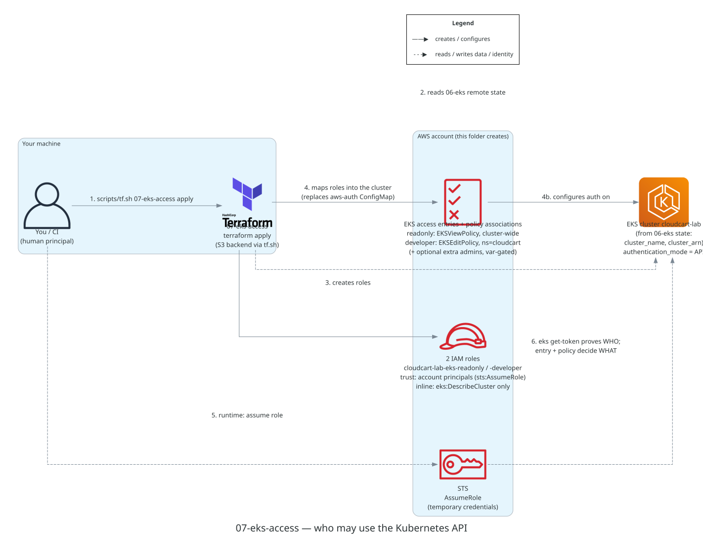

# 07-eks-access — who may use the Kubernetes API

## 1. Purpose
This folder decides **which humans and CI pipelines may talk to the cluster and what they may do**, using EKS access entries — the modern, Terraform-friendly replacement for the hand-edited `aws-auth` ConfigMap. It creates two demo roles (`readonly` = look at everything, change nothing; `developer` = edit workloads in one namespace only) plus optional extra admins, so CloudCart can demonstrate least-privilege access without IAM users or long-lived keys.

## 2. Architecture Diagram

Solid arrows provision; dashed arrows are runtime identity flow (assume-role, kubectl calls). This folder creates no compute — only IAM roles and EKS auth configuration.

## 3. Files Explained
| File | What it does | Why it exists |
|---|---|---|
| `versions.tf` / `providers.tf` / `common.tf` | Standard pins, empty S3 backend (injected by `scripts/tf.sh`), shared naming/tags. | State at `lab/07-eks-access/terraform.tfstate`; same boilerplate as every folder. |
| `data.tf` | Reads `06-eks` remote state. | Imports `cluster_name` and `cluster_arn`. |
| `variables.tf` | `extra_admin_principal_arns` (default `[]`), `developer_namespace` (default `cloudcart`). | Grant your SSO role admin without being locked out; choose the developer's namespace. |
| `main.tf` | 2 IAM roles + `eks:DescribeCluster` inline policy, access entries, policy associations, optional extra admins. | The whole auth model lives here, with WHY/GOES-WRONG comments. |
| `outputs.tf` | `readonly_role_arn`, `developer_role_arn`. | Used by humans/scripts to assume the roles and test 401/403 behaviour. |

## 4. How It Works
1. `scripts/tf.sh 07-eks-access apply` reads `06-eks` state to learn the cluster name and ARN.
2. Two **IAM roles** are created — `cloudcart-lab-eks-readonly` and `cloudcart-lab-eks-developer` — assumable by any principal in this account that also has `sts:AssumeRole` permission (lab posture; production would trust SSO permission-set roles and require MFA). Each gets an inline policy allowing only `eks:DescribeCluster`, so `aws eks update-kubeconfig` works — this grants **zero** Kubernetes rights.
3. An **access entry** (`aws_eks_access_entry`, type `STANDARD`) is created per role: this tells the EKS authenticator "this IAM principal is a known Kubernetes identity on this cluster". Without it you get `Unauthorized` (401) even with perfect IAM credentials.
4. An **access policy association** attaches an AWS-managed policy per role: `AmazonEKSViewPolicy` cluster-wide for readonly, `AmazonEKSEditPolicy` scoped to the `cloudcart` namespace for developer — the developer cannot see or touch anything outside that namespace.
5. Optionally, each ARN in `extra_admin_principal_arns` gets an entry plus `AmazonEKSClusterAdminPolicy`, so you are not locked out if the original creator identity disappears.
6. Runtime flow when a human uses it: `aws sts assume-role` -> `aws eks get-token` (a SigV4-presigned STS call proves WHO you are) -> the access entry maps you to a Kubernetes identity -> the associated access policy (and/or RBAC) decides WHAT you may do.

## 5. Dependencies and Outputs
- **Needs first:** `06-eks` (`cluster_name`, `cluster_arn`), and the cluster must run `authentication_mode = "API"` (it does — set in 06-eks).
- **Creates:** 2 IAM roles with inline `eks:DescribeCluster` policies, 2 access entries + 2 policy associations, and optionally one entry + cluster-admin association per ARN in `extra_admin_principal_arns`.
- **Consumed by:** no Terraform folder reads this folder's state (verified: no remote-state reference to `07-eks-access` exists); the role ARNs are used by humans and scripts to assume the roles. `kubernetes/rbac/deployer-role.yaml` demonstrates custom RBAC alongside access entries.
- **Verified from code:** `data.tf`, `main.tf`, `outputs.tf`, and a repo-wide search for consumers of this folder's state.
- **Uncertain:** `kubernetes/rbac/deployer-role.yaml` is referenced by the old README; not re-verified line by line for this rewrite.

## 6. How to Verify
No automated verifier exists yet (`scripts/verify.sh 07-eks-access` prints "No automated verifier"). Manual read-only checks:

| Command | Success means |
|---|---|
| `aws eks list-access-entries --cluster-name cloudcart-lab` | Entries for the readonly and developer roles exist |
| `aws eks list-associated-access-policies --cluster-name cloudcart-lab --principal-arn <role-arn>` | View (cluster) / Edit (namespace `cloudcart`) attached |
| `aws sts assume-role --role-arn <readonly_role_arn> --role-session-name test` then `kubectl get pods -A` | Lists work; `kubectl delete` anything is `Forbidden` (403) |
| `kubectl auth can-i delete pods -n kube-system --as <developer identity>` | `no` — namespace scope enforced |

## 7. Common Failure
- **401 "You must be logged in to the server (Unauthorized)"** — IAM authentication succeeded but there is no access entry for the assumed role. Check `aws eks list-access-entries` against `aws sts get-caller-identity`.
- **403 `Forbidden` on every command** — the entry exists but no policy association was attached (or the namespace scope excludes the resource). Check `list-associated-access-policies` and test with `kubectl auth can-i`.
- **`aws eks update-kubeconfig` fails with AccessDenied** — the role lacks `eks:DescribeCluster`; the inline policy from this folder is missing or you are assuming a different role than you think.

## 8. Interview Answer
**30-second answer:** "Cluster access has two separate gates: IAM authenticates you — `aws eks get-token` is just a presigned STS call — and EKS access entries map that IAM principal to a Kubernetes identity, with managed access policies deciding what you may do. I use API authentication mode, so all of this is declarative Terraform auditable in CloudTrail, not a hand-edited aws-auth ConfigMap that can lock everyone out. I demo it with a cluster-wide read-only role and a developer role whose edit rights stop at one namespace boundary."

**Likely follow-up — "401 vs 403?"** 401 Unauthorized means authentication failed at the cluster: your IAM principal has no access entry (or your token is invalid) — the API server does not know who you are. 403 Forbidden means you authenticated fine, but authorization denied the action: the access policy or RBAC binding does not allow that verb on that resource in that namespace. Diagnose 401 with `list-access-entries`, 403 with `kubectl auth can-i`.

*Lab vs production: account-root trust -> explicit SSO permission-set roles with MFA conditions · two demo roles -> one entry per team with namespace-scoped policies · creator admin retained -> break-glass admin only.*
