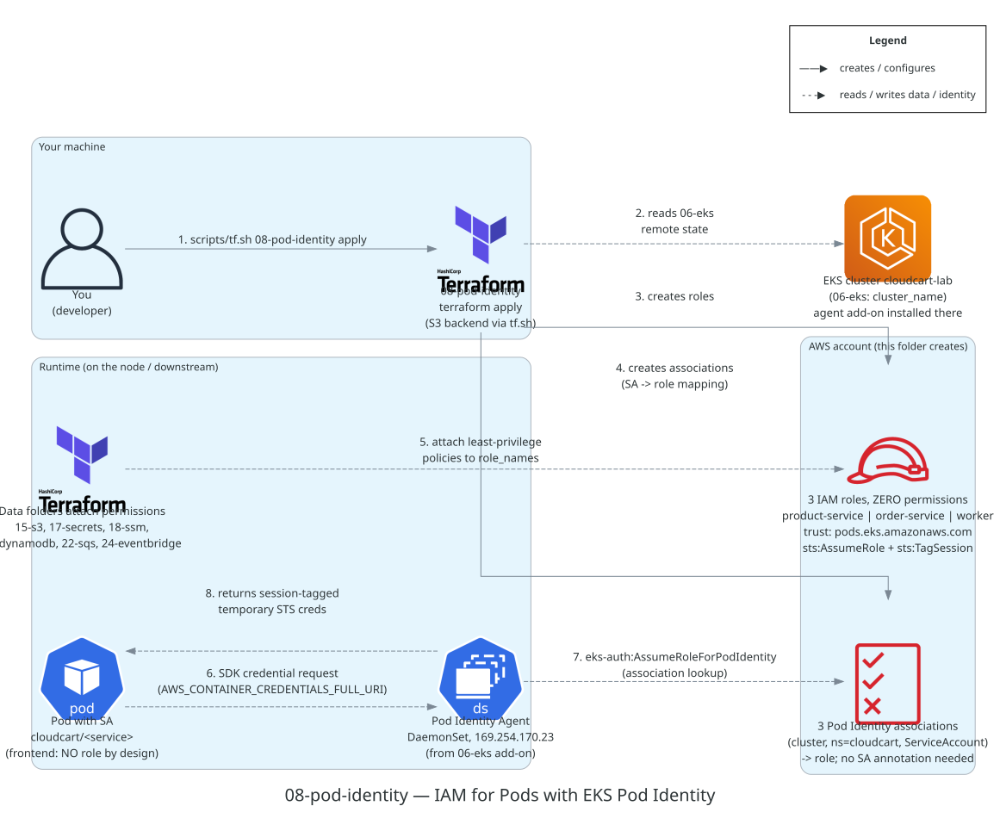

# 08-pod-identity — IAM for Pods with EKS Pod Identity

## 1. Purpose
CloudCart's pods must call AWS APIs (DynamoDB, S3, SQS...) without ever touching an access key. This folder creates **one IAM role per workload** (`product-service`, `order-service`, `worker`) and the **EKS Pod Identity associations** that bind each role to a Kubernetes ServiceAccount. It deliberately creates *no permissions*: the folder that owns each AWS resource attaches its own least-privilege policy to these roles, and the frontend gets **no role at all** — it only talks to in-cluster Services, so "no identity" is its least-privilege posture.

## 2. Architecture Diagram

Solid arrows provision; dashed arrows are the runtime credential flow. The Pod Identity Agent itself is installed in 06-eks — this folder only creates roles and associations.

## 3. Files Explained
| File | What it does | Why it exists |
|---|---|---|
| `versions.tf` / `providers.tf` / `common.tf` | Standard pins, empty S3 backend (injected by `scripts/tf.sh`), shared naming/tags. | State at `lab/08-pod-identity/terraform.tfstate`. |
| `data.tf` | Reads `06-eks` remote state. | Imports `cluster_name` for the associations. |
| `variables.tf` | `namespace` (default `cloudcart`). | Where the workload ServiceAccounts live. |
| `main.tf` | 3 `aws_iam_role` + 3 `aws_eks_pod_identity_association`; full Pod-Identity-vs-IRSA comparison in comments. | The whole mechanism, with WHY/GOES-WRONG comments. |
| `outputs.tf` | `role_names`, `role_arns`, `namespace`. | Data folders attach policies to `role_names`; 99-capstone checks the namespace matches. |

## 4. How It Works
1. `scripts/tf.sh 08-pod-identity apply` reads `06-eks` state for the cluster name.
2. Three **IAM roles** are created (`cloudcart-lab-product-service`, `-order-service`, `-worker`), all with the same trust policy: principal `pods.eks.amazonaws.com` may call `sts:AssumeRole` **and** `sts:TagSession`. TagSession lets EKS stamp session tags (cluster, namespace, ServiceAccount) onto the credentials — usable for ABAC and visible in CloudTrail.
3. Three **associations** are created: each says "any Pod using ServiceAccount `<name>` in namespace `cloudcart` on this cluster may assume this role". No annotation on the ServiceAccount is needed, and the ServiceAccount does not even have to exist yet.
4. Runtime credential flow (nothing here is provisioned by this folder — it is what the association enables): the Pod's AWS SDK finds `AWS_CONTAINER_CREDENTIALS_FULL_URI` (injected by the EKS Pod Identity webhook) -> asks the **Pod Identity Agent** DaemonSet at `169.254.170.23` -> the agent calls `eks-auth:AssumeRoleForPodIdentity` with the Pod's projected ServiceAccount token -> EKS looks up the association -> returns **temporary, auto-refreshed STS credentials** -> the SDK calls DynamoDB/S3/SQS.
5. **Permissions arrive later:** `15-s3`, `17-secrets-manager`, `18-parameter-store`, `20-dynamodb`, `22-sqs` and `24-eventbridge` each read `role_names` from this folder's state and attach only what their resource needs — so each data folder can be reviewed on its own ("who may touch my bucket?").
6. **Pod Identity vs IRSA (09-irsa):** Pod Identity needs no OIDC provider, the trust policy is identical for every cluster/role (a role is reusable across clusters), and the SA->role mapping is a single AWS API object. IRSA splits the mapping across a ServiceAccount annotation *and* a cluster-specific OIDC trust policy — but it is the only option on **Fargate** and works outside EKS-on-EC2. Rule of thumb here: Pod Identity by default, IRSA for Fargate.

## 5. Dependencies and Outputs
- **Needs first:** `06-eks` (`cluster_name`, and the `eks-pod-identity-agent` add-on installed there). No nodes are required — associations are an AWS API.
- **Creates:** 3 IAM roles (trust only, zero permissions) + 3 Pod Identity associations.
- **Consumed by:** `15-s3`, `17-secrets-manager`, `18-parameter-store`, `20-dynamodb`, `22-sqs`, `24-eventbridge` (attach policies to `role_names` — all verified remote-state reads); `99-capstone` (reads `namespace` and role outputs to validate the Helm release matches).
- **Verified from code:** `main.tf`, `outputs.tf`, and the `data.tf`/`access.tf` remote-state blocks of the consumer folders listed above.
- **Uncertain:** whether the `worker` ServiceAccount is consumed by exactly the same set of data folders as the two services (each folder's policy attachments were not enumerated line by line).

## 6. How to Verify
No automated verifier exists yet (`scripts/verify.sh 08-pod-identity` prints "No automated verifier"). Manual read-only checks:

| Command | Success means |
|---|---|
| `aws eks list-pod-identity-associations --cluster-name cloudcart-lab` | 3 associations in namespace `cloudcart` |
| `aws iam get-role --role-name cloudcart-lab-product-service` | Trust principal is `pods.eks.amazonaws.com` with `AssumeRole` + `TagSession` |
| `kubectl -n kube-system get ds eks-pod-identity-agent` | Agent DaemonSet running (installed by 06-eks) |
| `kubectl -n cloudcart exec deploy/product-service -- env \| grep AWS_CONTAINER` | `AWS_CONTAINER_CREDENTIALS_FULL_URI` injected — association is active |

## 7. Common Failure
- **`NoCredentialsError` in the pod** — association missing, or a typo in namespace/ServiceAccount name (it fails silently at association time), or the pod started *before* the association existed: restart the Deployment. Also confirm the agent DaemonSet is running.
- **Credentials work but `AccessDenied` on S3/DynamoDB** — the identity is fine; the *permission* is missing. Check `aws iam list-role-policies --role-name <role>` — the owning data folder (15-s3, 20-dynamodb...) may not be applied yet.
- **Pod on Fargate gets no credentials** — Pod Identity is not supported on Fargate (or Windows nodes). Use IRSA (09-irsa) there; 11-fargate relies on this.

## 8. Interview Answer
**30-second answer:** "Each workload gets its own IAM role, bound to its ServiceAccount by an EKS Pod Identity association — an AWS API object, so it's Terraform- and CloudTrail-friendly. At runtime the pod's SDK calls the Pod Identity agent on the node at 169.254.170.23, which exchanges the pod's identity for temporary STS credentials tagged with the cluster, namespace and ServiceAccount. No access keys, no node-role sharing, no OIDC provider, no ServiceAccount annotation. The role starts with zero permissions; the folder that owns each AWS resource attaches its own least-privilege policy."

**Likely follow-up — "Pod Identity vs IRSA?"** Both give per-ServiceAccount IAM roles. IRSA works through the cluster's OIDC provider: the mapping lives in two places — a ServiceAccount annotation *and* a role trust policy hard-coding that cluster's OIDC issuer — so reusing a role across clusters means editing trust. Pod Identity replaces all that with one association object and a cluster-independent trust policy, and adds session tags for ABAC. But IRSA still wins on Fargate, Windows nodes and outside EKS-on-EC2, which is why this project implements and tests both.

*Lab vs production: account-wide pod roles -> same, plus session-tag ABAC conditions, SCP guardrails, and one role per workload per environment.*
