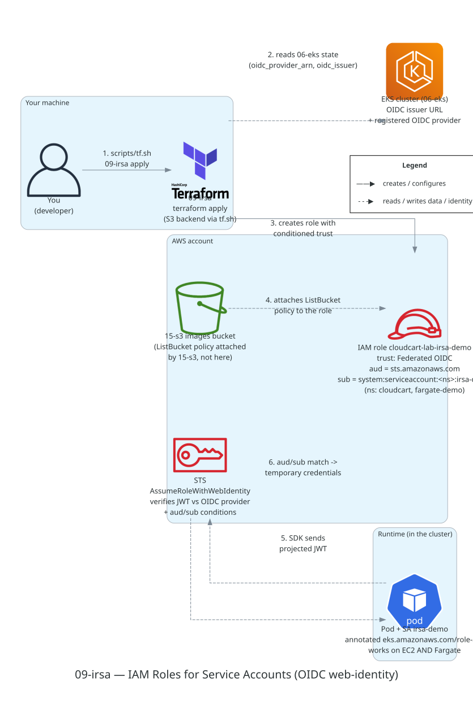

# 09-irsa — IAM Roles for Service Accounts (OIDC web-identity)

## 1. Purpose
This folder implements **IRSA**, the original pod-to-IAM mechanism: one demo role (`cloudcart-lab-irsa-demo`) that a Kubernetes ServiceAccount can assume through the cluster's **OIDC provider** (registered in 06-eks). CloudCart keeps it alongside Pod Identity (08) for two reasons: **Fargate does not support Pod Identity** (so IRSA is mandatory there), and interviewers expect you to compare both — the code comments and the demo let you prove each claim.

## 2. Architecture Diagram

Solid arrows provision; dashed arrows are the runtime web-identity flow. Only ONE role is created here — its permission (list the images bucket) is attached by 15-s3.

## 3. Files Explained
| File | What it does | Why it exists |
|---|---|---|
| `versions.tf` / `providers.tf` / `common.tf` | Standard pins, empty S3 backend (injected by `scripts/tf.sh`), shared naming/tags. | State at `lab/09-irsa/terraform.tfstate`. |
| `data.tf` | Reads `06-eks` remote state. | Imports `oidc_provider_arn` and `oidc_issuer` — the trust anchor. |
| `variables.tf` | `namespaces` (default `["cloudcart", "fargate-demo"]`), `service_account_name` (default `irsa-demo`). | Which ServiceAccounts may assume the demo role — one per namespace. |
| `main.tf` | One `aws_iam_role` with a **Federated** trust policy conditioned on `aud` and `sub`. | The `sub` condition IS the security boundary of IRSA. |
| `outputs.tf` | `irsa_demo_role_arn`, `irsa_demo_role_name`. | ARN goes into the SA annotation; 15-s3 attaches the ListBucket policy to the name. |

## 4. How It Works
1. `scripts/tf.sh 09-irsa apply` reads `06-eks` state for the OIDC provider ARN and issuer URL.
2. One **IAM role** is created with a Federated trust policy: the OIDC provider may call `sts:AssumeRoleWithWebIdentity`, but only when two conditions match — `aud = sts.amazonaws.com` (the token was minted for STS) and `sub = system:serviceaccount:<ns>:irsa-demo` for `cloudcart` and `fargate-demo`. **Forget the `sub` condition and ANY ServiceAccount in the cluster can assume the role** — a classic security finding.
3. No permission is attached here: `15-s3` (owner of the images bucket) attaches a ListBucket-only policy to this role — enough to prove the flow without granting data access.
4. Runtime flow (enabled by 06-eks + this role, driven by Kubernetes manifests `kubernetes/serviceaccounts/irsa-demo.yaml` and `kubernetes/fargate/irsa-test-pod.yaml`): the kubelet projects a signed JWT into the pod (issuer = cluster OIDC URL, audience = `sts.amazonaws.com`, subject = the ServiceAccount) -> the EKS pod-identity webhook reads the SA annotation `eks.amazonaws.com/role-arn` and sets `AWS_ROLE_ARN` + `AWS_WEB_IDENTITY_TOKEN_FILE` -> the AWS SDK calls **STS AssumeRoleWithWebIdentity** -> IAM verifies the JWT signature against the OIDC provider, evaluates the `aud`/`sub` conditions -> returns temporary credentials.
5. **IRSA vs Pod Identity (08):** IRSA splits the SA->role mapping across *two* places (the SA annotation in Kubernetes and the role trust policy in IAM) and the trust hard-codes the cluster's OIDC issuer — reusing a role in another cluster means editing trust. Pod Identity replaces that with a single association object and a cluster-independent trust. But IRSA works on **Fargate**, Windows nodes, EKS Anywhere and older SDKs, where Pod Identity cannot.

## 5. Dependencies and Outputs
- **Needs first:** `06-eks` (`oidc_provider_arn`, `oidc_issuer` — the OIDC provider is created there precisely for this folder and Fargate).
- **Creates:** exactly one IAM role (`cloudcart-lab-irsa-demo`) with the conditioned Federated trust; no policies attached here.
- **Consumed by:** `15-s3` (attaches the bucket-list permission to `irsa_demo_role_name` — verified remote-state read), `99-capstone` (reads this folder's state), and the Kubernetes manifests `kubernetes/serviceaccounts/irsa-demo.yaml` (SA annotation with the role ARN) and `kubernetes/fargate/irsa-test-pod.yaml`.
- **Verified from code:** `main.tf`, `data.tf`, `outputs.tf`, `15-s3/data.tf` + `15-s3/main.tf`, `99-capstone/data.tf`; both manifest files exist on disk.
- **Uncertain:** exact annotation wiring inside `irsa-demo.yaml` was confirmed to exist as a file, not re-validated line by line.

## 6. How to Verify
No automated verifier exists yet (`scripts/verify.sh 09-irsa` prints "No automated verifier"). Manual read-only checks:

| Command | Success means |
|---|---|
| `aws iam get-role --role-name cloudcart-lab-irsa-demo` | Trust = Federated OIDC provider with `aud` + `sub` conditions |
| `kubectl -n cloudcart get sa irsa-demo -o yaml` | Annotation `eks.amazonaws.com/role-arn` = the role ARN |
| `kubectl -n cloudcart exec irsa-test -- aws sts get-caller-identity` | Assumed role is `cloudcart-lab-irsa-demo` |
| `kubectl -n cloudcart exec irsa-test -- aws s3 ls s3://<images-bucket>` | List works; `aws s3 cp` into it is `AccessDenied` (least privilege) |

## 7. Common Failure
- **"Not authorized to perform sts:AssumeRoleWithWebIdentity"** — the `sub` condition does not match: typo in namespace or ServiceAccount name, or the pod runs in a namespace not listed in `var.namespaces`. Compare `aws iam get-role` trust with `kubectl get sa irsa-demo -o yaml`.
- **Pod has no `AWS_ROLE_ARN` env var** — the SA annotation is missing or the pod was created before the annotation existed; recreate the pod.
- **Works on EC2 nodes, fails on Fargate (or vice versa)** — the namespace list covers `cloudcart` but not `fargate-demo` (or the reverse); the `sub` condition must list every namespace where the SA is used.

## 8. Interview Answer
**30-second answer:** "IRSA federates the cluster's OIDC identity into IAM. The kubelet projects a signed ServiceAccount JWT into the pod; the SDK sends it to STS AssumeRoleWithWebIdentity; IAM verifies the signature against the cluster's registered OIDC provider and then evaluates the role's trust conditions — audience must be sts.amazonaws.com and subject must be exactly my ServiceAccount. That sub condition is the entire security boundary: without it, any pod in the cluster could take the role. I keep IRSA in the project because Fargate doesn't support Pod Identity, so it's the only option there."

**Likely follow-up — "What's in the JWT?"** Three claims matter: `iss` — the cluster's OIDC issuer URL, which selects which IAM OIDC provider validates the signature; `aud` — `sts.amazonaws.com`, proving the token was minted for STS and not some other audience; and `sub` — `system:serviceaccount:<namespace>:<name>`, which the trust policy pins so only that exact ServiceAccount can assume the role. The token is short-lived and rotated automatically by the kubelet.

*Lab vs production: two namespaces on one demo role -> one role per ServiceAccount per environment · StringEquals on sub -> same, never wildcards · same trust for all clusters -> per-cluster trust or migrate to Pod Identity where possible.*
