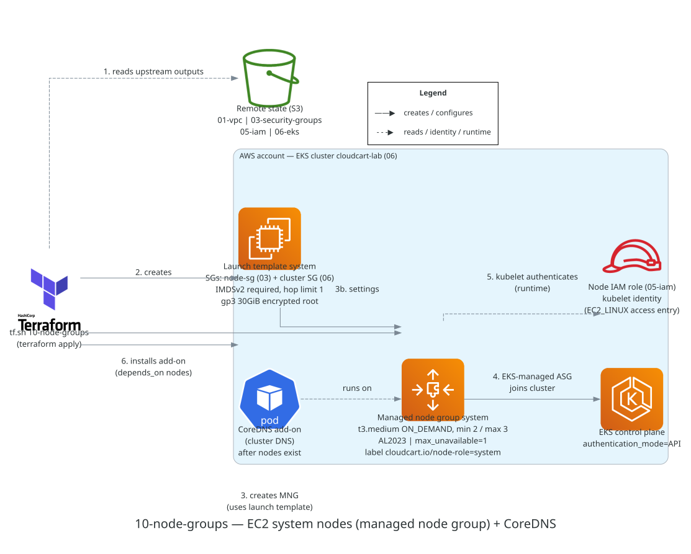

# 10-node-groups — EC2 system nodes (managed node group) + CoreDNS

## 1. Purpose
This folder gives the EKS cluster its first worker nodes: a small, always-on **managed node group called `system`** (2 x t3.medium by default) plus the **CoreDNS add-on**, which could not be installed in 06-eks because there were no nodes to run it. CloudCart needs this fixed pool to host the components that *create* capacity — Karpenter, the load balancer controller, CoreDNS — because Karpenter cannot run on nodes it provisions itself (chicken-and-egg). Application pods are meant to land on Karpenter nodes (12-karpenter), not here.

## 2. Architecture Diagram

Numbered arrows show the provisioning sequence; solid arrows create/configure, dashed arrows read data or carry identity. Node registration (step 5) is runtime behaviour EKS performs, not something Terraform does directly.

## 3. Files Explained
| File | What it does | Why it exists |
|---|---|---|
| `versions.tf` | Pins Terraform >= 1.11, AWS provider ~> 6.0, empty `backend "s3" {}`. | tf.sh injects bucket/key/region + `use_lockfile=true`; state at `lab/10-node-groups/terraform.tfstate`. |
| `providers.tf` | AWS provider with cost-allocation `default_tags`. | No credentials in code; every resource tagged with `Layer=10-node-groups`. |
| `common.tf` | Shared variables (`project`, `environment`, `region`, `state_bucket`), `local.name`, account id. | Generated from `terraform/_common`; identical in every folder. |
| `data.tf` | Reads remote state of `01-vpc`, `03-security-groups`, `05-iam`, `06-eks`; builds locals. | This folder is fully wired from upstream outputs — no hard-coded IDs. |
| `variables.tf` | `system_instance_types` (t3.medium), `system_capacity_type` (ON_DEMAND), sizes 2/2/3, disk 30 GiB, `taint_system_nodes` (false). | One place to resize the pool or dedicate it to system pods. |
| `main.tf` | Launch template + `aws_eks_node_group.system` + `aws_eks_addon.coredns`. | The actual infrastructure; every resource carries WHY/GOES-WRONG comments. |
| `outputs.tf` | `system_node_group_name`, `launch_template_id`. | For humans/scripts; no other folder reads this state. |
| `diagrams/` | `architecture.svg` + the script that regenerates it. | The picture above. |

## 4. How It Works
1. `scripts/tf.sh 10-node-groups apply` inits with the injected S3 backend, then plans against the four upstream states read in `data.tf`.
2. Terraform creates the **launch template**: security groups `[node-sg (03), cluster SG (06)]` (listing any SG replaces the default, so the cluster SG must be explicit or nodes cannot reach the API), **IMDSv2 required with hop limit 1** (a pod is one hop beyond the node, so pods cannot steal node-role credentials from the metadata service), **gp3 30 GiB encrypted root volume** with delete-on-termination, instance/volume cost tags, `create_before_destroy`.
3. Terraform creates the **managed node group `system`**: AMI family `AL2023_x86_64_STANDARD`, instance types `[t3.medium]`, `ON_DEMAND` (var allows SPOT), desired/min **2**, max **3**, spread across the private subnets, rolling updates with `max_unavailable = 1`, label `cloudcart.io/node-role=system`. An optional `CriticalAddonsOnly:NoSchedule` taint is var-gated (default off in the lab). `desired_size` is `ignore_changes` after creation so Terraform never fights an autoscaler.
4. At boot, `nodeadm` configures the kubelet, which authenticates with the **node IAM role from 05-iam** (EKS auto-creates the `EC2_LINUX` access entry for managed node groups); the node goes Ready once the VPC CNI add-on is running on it.
5. Only then does Terraform install the **CoreDNS add-on** (`depends_on` the node group) — pods resolve names via the cluster DNS service IP (x.x.x.10), which forwards non-cluster names to the VPC resolver (.2).

Cost: 2 x t3.medium ~ $60/month + EBS — destroy the lab when idle.

## 5. Dependencies and Outputs
- **Needs first:** `01-vpc` (`private_subnet_ids`), `03-security-groups` (`node_security_group_id`), `05-iam` (`node_role_arn`), `06-eks` (`cluster_name`, `cluster_security_group_id`) — all via `terraform_remote_state` in `data.tf`.
- **Creates:** one launch template, the `system` managed node group (its ASG/instances are AWS-side), the CoreDNS add-on.
- **Consumed by:** `12-karpenter` functionally — its controller is pinned to these nodes via `nodeSelector cloudcart.io/node-role=system`; `scripts/verify.sh` (`verify_10_node_groups`); humans via `outputs.tf`. No folder reads this state with `terraform_remote_state`.
- **Verified from code:** `main.tf`, `data.tf`, `variables.tf`, `outputs.tf`, `scripts/verify.sh`, `terraform/12-karpenter/main.tf` (nodeSelector).
- **Uncertain:** whether the lab currently runs with the optional system taint enabled (var default is `false`).

## 6. How to Verify
`scripts/verify.sh 10-node-groups` has a built-in verifier; the underlying read-only checks:

| Command | Success means |
|---|---|
| `aws eks describe-nodegroup --cluster-name cloudcart-lab --nodegroup-name system --query nodegroup.status` | `ACTIVE` |
| `kubectl get nodes --no-headers` | every node `Ready` (2-3 `t3.medium`) |
| `aws eks describe-addon --cluster-name cloudcart-lab --addon-name coredns --query addon.status` | `ACTIVE` |
| `kubectl -n kube-system get pods -l k8s-app=kube-dns` | CoreDNS pods `Running` |

## 7. Common Failure
- **Nodes stay `NotReady`** — cluster SG missing from the launch template, CNI add-on unhealthy, or no route to the API/ECR (NAT/endpoints). Diagnose: `kubectl describe node`, then compare instance SGs with `aws ec2 describe-instances`.
- **Node group `CREATE_FAILED` / `NodeCreationFailure`** — instances booted but could not join: SG or access-entry problem. Read `aws eks describe-nodegroup ... --query nodegroup.health`.
- **Every pod name lookup fails** ("Temporary failure in name resolution") — CoreDNS not Running or UDP 53 blocked between nodes; check the add-on status and the node SG self-referencing rules from 03-security-groups.

## 8. Interview Answer
**30-second answer:** "The cluster has one small managed node group called `system` — two t3.mediums on AL2023, On-Demand, min 2 max 3 — that exists purely to run the things that create capacity: CoreDNS, Karpenter, the load balancer controller. It's built from a launch template because that's the only way to attach our own node security group alongside the cluster SG, enforce IMDSv2 with hop limit 1 so pods can't steal node credentials, and encrypt the gp3 root volume. Application pods don't belong here — Karpenter provisions right-sized, often Spot, nodes for them; Karpenter can't run on nodes it manages, so this pool is not optional."

**Likely follow-up — "Why not just use Karpenter or Fargate for everything?"** Karpenter needs somewhere to run before it can create nodes, and Fargate can't run DaemonSets like the CNI or support every add-on — so a minimal, fixed, On-Demand pool is the bootstrap substrate. Terraform also ignores `desired_size` after creation, so an autoscaler can resize the pool without Terraform reverting it on the next apply.

*Lab vs production: 2 x t3.medium -> 3 AZ with Graviton, taint the system pool `CriticalAddonsOnly` and give apps only Karpenter nodes, consider SPOT only for non-critical pools.*
