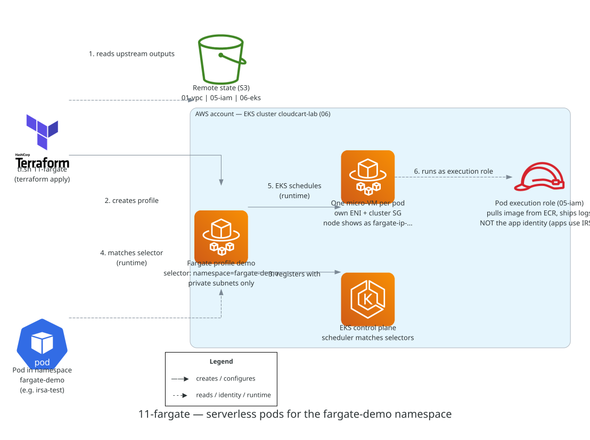

# 11-fargate — serverless pods for the fargate-demo namespace

## 1. Purpose
This folder creates **one EKS Fargate profile named `demo`** that schedules every pod in the `fargate-demo` namespace onto AWS-managed micro-VMs — no EC2 nodes to patch, scale or pay for when idle. CloudCart uses it as an isolation/cost demo and, more importantly, as the one place where **IRSA is required**: EKS Pod Identity is not supported on Fargate, so pod AWS access there must come from IRSA (09-irsa).

## 2. Architecture Diagram

Numbered arrows show the provisioning sequence; solid arrows create/configure, dashed arrows are data or identity flows. Only step 2 is Terraform — selector matching and micro-VM scheduling are EKS runtime behaviour.

## 3. Files Explained
| File | What it does | Why it exists |
|---|---|---|
| `versions.tf` | Pins Terraform >= 1.11, AWS provider ~> 6.0, empty `backend "s3" {}`. | tf.sh injects bucket/key/region + `use_lockfile=true`; state at `lab/11-fargate/terraform.tfstate`. |
| `providers.tf` | AWS provider with cost-allocation `default_tags`. | No credentials in code; tagged `Layer=11-fargate`. |
| `common.tf` | Shared variables, `local.name`, account id. | Generated from `terraform/_common`; identical everywhere. |
| `data.tf` | Reads remote state of `01-vpc`, `05-iam`, `06-eks`; builds locals. | Cluster name, private subnets and the execution role come from upstream — no hard-coded IDs. |
| `variables.tf` | `fargate_namespace` (default `fargate-demo`). | The single selector the profile matches on. |
| `main.tf` | The one resource: `aws_eks_fargate_profile.demo`. | The entire infrastructure of this folder; header comment lists when Fargate does NOT fit. |
| `outputs.tf` | `fargate_profile_name`, `fargate_namespace`. | For humans/scripts; no other folder reads this state. |
| `diagrams/` | `architecture.svg` + the script that regenerates it. | The picture above. |

## 4. How It Works
1. `scripts/tf.sh 11-fargate apply` inits with the injected S3 backend and reads the three upstream states.
2. Terraform creates the Fargate profile `demo` on cluster `cloudcart-lab`: **selector = namespace `fargate-demo`** (no label conditions), **private subnets only** (Fargate pods never run in public subnets), and the **pod execution role from 05-iam** — the identity Fargate itself uses to pull the image from ECR and ship logs. It is *not* the application's identity.
3. At runtime, any pod created in `fargate-demo` matches the selector; EKS provisions **one micro-VM per pod** with its own ENI (private subnet, cluster security group) — the node appears as `fargate-ip-...` after ~1 minute of provisioning.
4. The pod's AWS permissions come from **IRSA** (09-irsa, annotated ServiceAccount), never from Pod Identity — unsupported on Fargate by design.
5. Billing is per pod vCPU/GB-second with a 1-minute minimum: **$0 when no pods run**, so the profile itself is free to keep.

Limits that matter (from the code comments): no DaemonSets, GPUs, privileged pods, EBS volumes, or cheap Spot-shaped capacity on Fargate.

## 5. Dependencies and Outputs
- **Needs first:** `01-vpc` (`private_subnet_ids`), `05-iam` (`fargate_role_arn`), `06-eks` (`cluster_name`) — via `terraform_remote_state` in `data.tf`. CoreDNS must already run on EC2 nodes (10-node-groups) — the profile does not cover `kube-system`.
- **Creates:** exactly one `aws_eks_fargate_profile` (`demo`).
- **Consumed by:** `kubernetes/namespaces/fargate-demo.yaml` (the namespace that activates the selector) and `kubernetes/fargate/irsa-test-pod.yaml` (the IRSA-on-Fargate test pod). No folder reads this state with `terraform_remote_state`.
- **Verified from code:** `main.tf`, `data.tf`, `variables.tf`, `outputs.tf`, `kubernetes/fargate/irsa-test-pod.yaml`, presence of `kubernetes/namespaces/fargate-demo.yaml`.
- **Uncertain:** none.

## 6. How to Verify
`scripts/verify.sh` has **no verifier for 11-fargate** — use these read-only commands:

| Command | Success means |
|---|---|
| `aws eks describe-fargate-profile --cluster-name cloudcart-lab --fargate-profile-name demo --query fargateProfile.status` | `ACTIVE` |
| `kubectl -n fargate-demo get pods -o wide` | pod `Running`, node name starts with `fargate-ip-` |
| `kubectl -n fargate-demo exec irsa-test -- aws sts get-caller-identity` | shows the assumed IRSA role, not a node role |

## 7. Common Failure
- **Pod stays `Pending` with "0/N nodes available"** — namespace/labels do not match the selector (the profile matches only namespace `fargate-demo`), or the profile is not yet `ACTIVE`. Check the selector and profile status.
- **Pod Identity does nothing on Fargate** — unsupported by design; the fix is IRSA from 09-irsa. This is a favourite interview trap.
- **Every pod in the cluster fails DNS after moving CoreDNS** — CoreDNS must keep running on EC2 nodes; this profile deliberately does not select `kube-system`.

## 8. Interview Answer
**30-second answer:** "Fargate runs each pod in its own micro-VM with its own kernel and ENI, so there is no node to manage and you pay per pod-second with nothing running costing zero. This cluster has exactly one profile: it selects the `fargate-demo` namespace into private subnets with a dedicated execution role that only pulls images and ships logs. The sharp edges are what Fargate can't do — no DaemonSets, GPUs, privileged pods or EBS volumes — and Pod Identity is unsupported there, so pods on Fargate get AWS permissions through IRSA instead."

**Likely follow-up — "When would you NOT use Fargate?"** DaemonSet-based agents (CNI, monitoring), stateful workloads on EBS, privileged pods, GPU workloads, and cost-sensitive steady-state load — per-second billing beats EC2 only for bursty or strongly isolated workloads. In CloudCart that's why the real services run on EC2 nodes (10/12) and Fargate is a targeted demo namespace.

*Lab vs production: same profile pattern, but split selectors by namespace+labels per workload, right-size pod requests (billing follows them), and keep CoreDNS/system pods pinned to EC2.*
