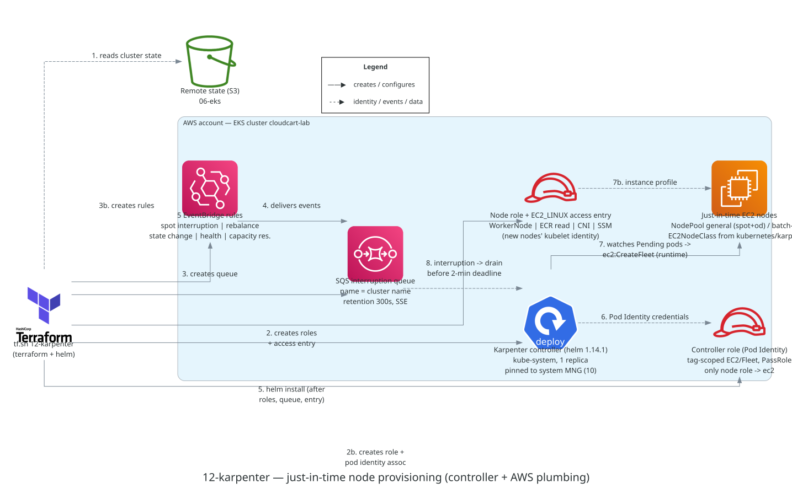

# 12-karpenter — just-in-time node provisioning (controller + AWS plumbing)

## 1. Purpose
This folder installs the **Karpenter controller** and every AWS resource it needs: a node IAM role with an EKS access entry, a tag-scoped controller role bound via Pod Identity, and a Spot-interruption pipeline (EventBridge → SQS). CloudCart uses Karpenter for application capacity because it provisions **right-sized nodes just in time** instead of running a static, pre-sized node group — the system pool from 10-node-groups stays tiny and apps get cheap, often Spot, capacity on demand. The actual scheduling policy (NodePools, EC2NodeClass) is Kubernetes config and lives in `kubernetes/karpenter/`, applied separately.

## 2. Architecture Diagram

Numbered arrows show the provisioning sequence; solid arrows create/configure, dashed arrows carry identity, events or runtime flows. Terraform creates the AWS plumbing and installs the controller; what Karpenter may build is defined later by `kubernetes/karpenter/`.

## 3. Files Explained
| File | What it does | Why it exists |
|---|---|---|
| `versions.tf` | Terraform >= 1.11, AWS ~> 6.0 **plus kubernetes ~> 2.38 and helm ~> 2.17**, empty `backend "s3" {}`. | This folder talks to both AWS and the Kubernetes API; state at `lab/12-karpenter/terraform.tfstate`. |
| `providers.tf` | AWS provider with `default_tags`. | Same convention as every folder. |
| `common.tf` | Shared variables, `local.name`, account id/partition. | Generated from `terraform/_common`. |
| `k8s.tf` | Reads `06-eks` remote state; configures `kubernetes`/`helm` providers with `aws eks get-token` exec auth. | Generated from `terraform/_common_k8s`; no static tokens. |
| `variables.tf` | `karpenter_version` (default `1.14.1`), `controller_replicas` (default 1). | Chart version must match the Kubernetes minor (karpenter.sh compatibility matrix). |
| `main.tf` | Node role + access entry, SQS queue + 5 EventBridge rules, controller role + inline policy + Pod Identity association, `helm_release.karpenter`. | All the AWS plumbing plus the controller install. |
| `outputs.tf` | `node_role_name`, `node_role_arn`, `controller_role_arn`, `interruption_queue_name`. | `node_role_name` is consumed by `scripts/deploy-karpenter.sh` to render the EC2NodeClass. |
| `diagrams/` | `architecture.svg` + the script that regenerates it. | The picture above. |

## 4. How It Works
1. `scripts/tf.sh 12-karpenter apply` reads the `06-eks` state (`k8s.tf`); the kubernetes/helm providers authenticate per-run via `aws eks get-token` against the API-mode cluster.
2. **Node role** `cloudcart-lab-karpenter-node` (trusted by `ec2.amazonaws.com`) gets four managed policies — `AmazonEKSWorkerNodePolicy`, `AmazonEC2ContainerRegistryReadOnly`, `AmazonEKS_CNI_Policy`, `AmazonSSMManagedInstanceCore` — plus an `aws_eks_access_entry` of **type `EC2_LINUX`**. With `authentication_mode=API` this entry is not automatic for non-MNG roles; without it instances launch (and bill) but never join.
3. **Interruption pipeline:** an SQS queue **named after the cluster** (300s retention, SQS-managed SSE, policy allowing only `events.amazonaws.com`/`sqs.amazonaws.com` to send, denying non-TLS) plus **five** EventBridge rules → targets: Spot interruption warning, instance rebalance recommendation, instance state change, AWS Health event, and capacity-reservation interruption. Spot gives 2 minutes' notice; Karpenter drains first.
4. **Controller role** trusted by `pods.eks.amazonaws.com` (Pod Identity), with an inline policy mirroring the official Karpenter v1 CloudFormation template: `ec2:RunInstances`/`CreateFleet` and tagging scoped by request/resource tags (`kubernetes.io/cluster/<cluster>=owned`, `eks:eks-cluster-name`, `karpenter.sh/nodepool`), regional describes restricted to `var.region`, SSM `GetParameter` for AMI aliases, Pricing read, SQS read on the interruption queue, `eks:DescribeCluster`, and **`iam:PassRole` only for the node role and only to EC2** — the privilege-escalation-sensitive line.
5. An `aws_eks_pod_identity_association` binds that role to ServiceAccount `karpenter` in `kube-system` (requires the Pod Identity agent from 08-pod-identity).
6. **Helm install** of chart `oci://public.ecr.aws/karpenter/karpenter` version **1.14.1**: 1 replica (lab), `nodeSelector cloudcart.io/node-role=system` so the controller runs on the 10-node-groups pool and never on nodes it manages, toleration for `CriticalAddonsOnly`, settings `clusterName` + `interruptionQueue`, explicit `AWS_REGION` env (IMDSv2 hop limit 1 blocks metadata discovery), requests 250m/512Mi, limit 1Gi. The release `depends_on` the association, policy, access entry and event targets.
7. **Handoff:** `scripts/deploy-karpenter.sh` reads `node_role_name` from this state and applies `kubernetes/karpenter/`: EC2NodeClass `default` (AL2023 alias, subnets/SGs by `karpenter.sh/discovery` tag, gp3 30 GiB encrypted, IMDSv2 hop 1), NodePool `general` (spot+on-demand, c/m/r gen>4, large–2xlarge, cpu limit 16, `expireAfter 720h`, consolidate `WhenEmptyOrUnderutilized` after 1m) and tainted Spot-only NodePool `batch-spot`.

## 5. Dependencies and Outputs
- **Needs first:** `06-eks` (`cluster_name`, `cluster_arn`, endpoint/CA — via `terraform_remote_state` in `k8s.tf`); functionally `08-pod-identity` (agent add-on) and `10-node-groups` (system nodes the controller is pinned to). The EC2NodeClass also relies on `karpenter.sh/discovery` tags set by 01-vpc/03-security-groups.
- **Creates:** 2 IAM roles (node, controller) + 4 managed-policy attachments + 1 inline controller policy, 1 EKS access entry, 1 SQS queue + queue policy, 5 EventBridge rules + 5 targets, 1 Pod Identity association, 1 Helm release.
- **Consumed by:** `scripts/deploy-karpenter.sh` (reads `node_role_name` from this state) and `kubernetes/karpenter/*.yaml`; `scripts/verify.sh` (`verify_12_karpenter`). No Terraform folder reads this state.
- **Verified from code:** `main.tf`, `k8s.tf`, `variables.tf`, `outputs.tf`, `scripts/deploy-karpenter.sh`, `kubernetes/karpenter/*.yaml`, `scripts/verify.sh`.
- **Uncertain:** the pre-rewrite README said "four EventBridge rules" — the code defines five (capacity-reservation was added); code wins. Interruption flow not verified against a live account.

## 6. How to Verify
`scripts/verify.sh 12-karpenter` polls the controller rollout. Read-only checks:

| Command | Success means |
|---|---|
| `kubectl -n kube-system rollout status deploy/karpenter` | `successfully rolled out` (>= 1 available replica) |
| `kubectl get nodepools,ec2nodeclasses` | `general` + `batch-spot` pools, node class `Ready` (after deploy-karpenter.sh) |
| `kubectl get nodeclaims` | NodeClaims appear when pods are unschedulable |
| `kubectl -n kube-system logs deploy/karpenter --tail=50` | no `AccessDenied` / `UnauthorizedOperation`; provisioning decisions visible |

## 7. Common Failure
- **Pods Pending, Karpenter never launches capacity** — read the controller log: no NodePool matches the pod (requirements/taints), the pool's `limits.cpu: 16` guardrail is hit, or the EC2NodeClass is not Ready because discovery tags on subnets/SGs are missing.
- **Instances launch but nodes never join** — missing/wrong `EC2_LINUX` access entry for the node role, or no SG/route to the API; kubelet logs `Unauthorized`. You pay for the instances meanwhile.
- **Helm install fails pulling from `public.ecr.aws` (403)** — stale ECR credentials in `~/.docker/config.json`; fix with `docker logout public.ecr.aws`. Controller `CrashLoopBackOff` "no credentials" = Pod Identity association typo (namespace `kube-system`, SA `karpenter`).

## 8. Interview Answer
**30-second answer:** "Karpenter watches for unschedulable pods and calls EC2 Fleet directly — no Auto Scaling Groups — picking the cheapest instance types that satisfy each pending pod's requests, then consolidating or expiring nodes later. This repo wires it properly: the controller runs on the small system node group because it can't run on nodes it creates; it authenticates with Pod Identity through a role whose policy is scoped by cluster tags, with `iam:PassRole` allowed only for the node role; new nodes join via an explicit `EC2_LINUX` access entry because the cluster uses API authentication; and Spot interruptions flow EventBridge to SQS so Karpenter drains before the 2-minute deadline. Terraform creates only the AWS plumbing and the controller — the NodePools and EC2NodeClass are Kubernetes manifests applied afterwards."

**Likely follow-up — "Karpenter vs Cluster Autoscaler?"** Cluster Autoscaler scales pre-defined ASGs — fixed instance shape per group, slower reaction, bin-packing limited to what you pre-declared. Karpenter has no ASGs: it evaluates the whole instance catalogue per pending-pod batch, launches directly via CreateFleet, handles Spot rebalance/interruption natively through the SQS queue, and proactively consolidates underused nodes (`WhenEmptyOrUnderutilized`, 1 minute here) and expires nodes after 720h to pick up fresh AMIs.

*Lab vs production: 1 replica -> 2 leader-elected replicas on dedicated nodes, pin the AMI alias instead of `al2023@latest`, add disruption budgets, diversify Spot pools, alert on provisioning failures.*
