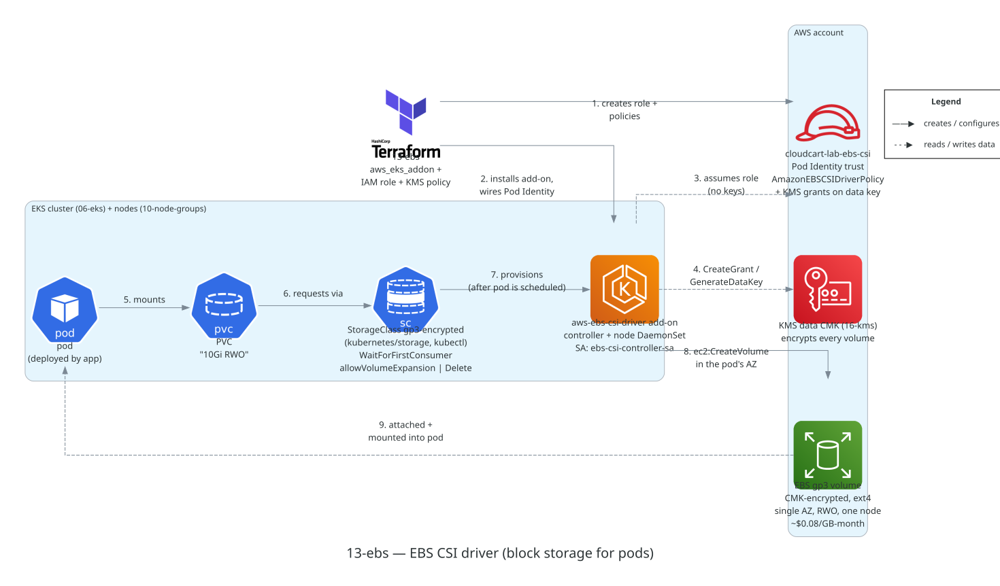

# 13-ebs — EBS CSI driver (block storage for pods)

## 1. Purpose
This folder installs the **EBS CSI driver** as a managed EKS add-on so pods can get dynamically provisioned EBS block volumes from PVCs. It creates the IAM role the driver assumes via **Pod Identity**, attaches the AWS-managed driver policy, and adds an inline KMS policy so volumes can be encrypted with the data CMK from `16-kms`. The actual StorageClass and demo PVCs are Kubernetes objects that live in `kubernetes/storage/` — this folder only provisions the AWS side.

## 2. Architecture Diagram

Solid arrows provision or wire identity; dashed arrows move data/credentials. The StorageClass and PVCs are applied with kubectl, not Terraform — the runtime flow (PVC → CreateVolume → attached volume) happens outside this folder.

## 3. Files Explained
| File | What it does | Why it exists |
|---|---|---|
| `versions.tf` / `providers.tf` | Standard pins (TF >= 1.11, AWS ~> 6.0), empty `backend "s3" {}` injected by `scripts/tf.sh`, cost-allocation tags. | Same boilerplate as every folder; state lands at `lab/13-ebs/terraform.tfstate`. |
| `common.tf` | Shared naming/tags: role prefix = `cloudcart-lab`. | Generated from `_common`; two environments can never collide. |
| `data.tf` | Reads remote state of `06-eks` (`cluster_name`) and `16-kms` (`data_key_arn`). | Imports the cluster to attach the add-on to and the CMK for encrypted volumes. |
| `variables.tf` | `ebs_csi_addon_version` (default `null`). | `null` = the EKS default add-on version for the cluster's Kubernetes minor; pin it to freeze upgrades. |
| `main.tf` | The Pod Identity role, `AmazonEBSCSIDriverPolicy` attachment, inline KMS policy, and the `aws_eks_addon`. | The actual infrastructure; every resource carries WHY/DEPENDS/GOES-WRONG comments. |
| `outputs.tf` | Exports `ebs_csi_role_arn` and `data_key_arn_for_storageclass`. | Read by scripts/humans (verification, rendering the StorageClass); no Terraform folder consumes them. |
| `diagrams/` | `architecture.svg` + the Python script that regenerates it. | The picture above. |

## 4. How It Works
1. `scripts/tf.sh 13-ebs apply` injects the S3 backend config, and Terraform reads the state of `06-eks` (cluster name) and `16-kms` (data key ARN).
2. An **IAM role** `cloudcart-lab-ebs-csi` is created with a Pod Identity trust policy (`pods.eks.amazonaws.com` may `AssumeRole` + `TagSession`). The AWS-managed `AmazonEBSCSIDriverPolicy` is attached — it grants the `ec2:CreateVolume`/`AttachVolume`/`CreateTags` calls the controller makes.
3. An **inline KMS policy** on the same role allows two things on the data key only: managing grants scoped by `kms:GrantIsForAWSResource=true` (`CreateGrant`/`ListGrants`/`RevokeGrant`), and direct key use (`Encrypt`, `Decrypt`, `ReEncrypt*`, `GenerateDataKey*`, `DescribeKey`). Without the grants, EC2 cannot attach CMK-encrypted volumes.
4. The **`aws-ebs-csi-driver` managed add-on** is installed with a `pod_identity_association` wiring the `ebs-csi-controller-sa` ServiceAccount to the role — no annotations, no access keys. `resolve_conflicts = OVERWRITE` on create and update; the version comes from `ebs_csi_addon_version` (null = EKS default). The add-on explicitly `depends_on` both IAM policies so the controller never starts unauthorized.
5. At **runtime** (outside Terraform): the `gp3-encrypted` StorageClass in `kubernetes/storage/storageclass-ebs.yaml` (gp3, `encrypted: "true"`, `kmsKeyId` = the data key, ext4, `allowVolumeExpansion: true`, `reclaimPolicy: Delete`) uses `volumeBindingMode: WaitForFirstConsumer` — the volume is created **in the pod's AZ only after scheduling**. PVC deletion deletes the volume (lab default).
6. Cost: **gp3 ~$0.08/GB-month**. Volumes created by PVCs live outside Terraform — delete PVCs before destroying the cluster or they keep billing.

## 5. Dependencies and Outputs
- **Needs first:** `06-eks` (`cluster_name`) and `16-kms` (`data_key_arn`) — both read via `terraform_remote_state` in `data.tf`. At runtime the controller Deployment also needs nodes (`10-node-groups`) to schedule on; the header comment declares that, but no Terraform state of `10-node-groups` is read here.
- **Creates:** the Pod Identity role + managed policy attachment + inline KMS policy, and the `aws-ebs-csi-driver` EKS add-on with its pod identity association.
- **Consumed by:** no Terraform folder reads this state (verified: `13-ebs` appears in other folders only inside comments, never in a `terraform_remote_state` block). Consumers are `kubernetes/storage/storageclass-ebs.yaml` (rendered with the `data_key_arn_for_storageclass` value) and the demo PVCs in the same directory — via scripts/humans.
- **Verified from code:** the two remote-state reads (`data.tf`), every resource and its comments (`main.tf`), both outputs (`outputs.tf`), and the StorageClass parameters (`kubernetes/storage/storageclass-ebs.yaml`).
- **Uncertain:** whether the add-on is currently applied in the AWS account (not checked, per safety rules).

## 6. How to Verify
`scripts/verify.sh` has **no automated verifier for 13-ebs** — use these read-only checks:

| Command | Success means |
|---|---|
| `aws eks describe-addon --cluster-name cloudcart-lab --addon-name aws-ebs-csi-driver --query addon.status` | `ACTIVE` |
| `kubectl -n kube-system rollout status deploy/ebs-csi-controller` | rollout complete — controller pods running on nodes |
| `kubectl get csidrivers` | `ebs.csi.aws.com` registered |
| `aws iam get-role --role-name cloudcart-lab-ebs-csi --query 'Role.AssumeRolePolicyDocument'` | trust principal is `pods.eks.amazonaws.com` |

The strongest end-to-end proof is the demo in `kubernetes/storage/ebs-demo.yaml`: PVC goes Bound after the pod schedules, and the file written to `/data` survives a pod delete+recreate.

## 7. Common Failure
- **Pod stuck `ContainerCreating`: "KMS key ... is not authorized"** — the CSI role lacks grant permissions, or the key policy in `16-kms` does not delegate to IAM. Confirm the inline policy exists: `aws iam get-role-policy --role-name cloudcart-lab-ebs-csi use-data-key`.
- **PVC stays `Pending` forever** — with `WaitForFirstConsumer` this is normal until a pod uses the PVC. If a pod exists and it is still pending, the controller is unhealthy: `kubectl -n kube-system logs deploy/ebs-csi-controller`.
- **"volume node affinity conflict" on reschedule** — the pod moved AZs and EBS volumes are single-AZ (ReadWriteOnce, one node). Cordon/drain back to the original AZ, or snapshot the volume and create a new one in the target AZ.

**Cleanup warning (destructive):** `reclaimPolicy: Delete` means deleting the PVC deletes the volume and its data. Snapshot first if the data matters; `scripts/destroy-all.sh` deletes PVCs before tearing the cluster down.

## 8. Interview Answer
**30-second answer:** "EBS is single-AZ block storage — one volume attaches to one node, ReadWriteOnce. I install the EBS CSI driver as a managed EKS add-on and give the controller a Pod Identity role with the AWS-managed driver policy plus an inline KMS policy, because our StorageClass encrypts every volume with our own CMK — without the grant permissions the PVC is created but the pod never mounts. The StorageClass uses WaitForFirstConsumer so the volume is born in the same AZ as the pod, and reclaimPolicy Delete in the lab because leftover volumes keep billing after Terraform is done."

**Likely follow-up — "EBS vs EFS?"** EBS is zonal block storage attached to a single node — fast, RWO, the volume cannot follow a pod across AZs (snapshots are the cross-AZ/backup mechanism). EFS is a regional NFS service mountable by many pods in many AZs at once (RWX) at higher latency and price — in this project that is `14-efs` with its own CSI driver. Rule of thumb: databases and stateful single-replica workloads → EBS; shared content and scale-out reads → EFS.

*Lab vs production: reclaimPolicy Delete -> Retain + snapshots + AWS Backup (40-backup) · add-on version null (EKS default) -> pinned version rolled out through CI.*
