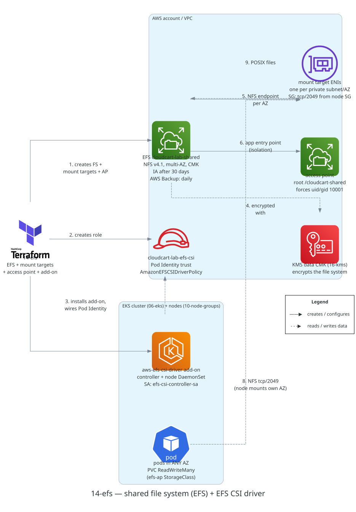

# 14-efs — shared file system (EFS) + EFS CSI driver

## 1. Purpose
This folder creates the **EFS file system** — a managed, multi-AZ NFS service that many pods on many nodes can mount at once (ReadWriteMany) — plus its mount targets, an access point, and the **EFS CSI driver** add-on with a Pod Identity role. It answers the EBS limitation: when a workload needs a POSIX filesystem shared across AZs instead of block storage pinned to one node. The StorageClass and demo manifests live in `kubernetes/storage/`; this folder provisions the AWS side.

## 2. Architecture Diagram

Solid arrows provision; dashed arrows carry NFS data or credentials. Pods in any AZ reach the mount target ENI in their own AZ over tcp/2049 — the data is replicated across AZs inside EFS.

## 3. Files Explained
| File | What it does | Why it exists |
|---|---|---|
| `versions.tf` / `providers.tf` | Standard pins (TF >= 1.11, AWS ~> 6.0), empty `backend "s3" {}` injected by `scripts/tf.sh`, cost-allocation tags. | Same boilerplate as every folder; state lands at `lab/14-efs/terraform.tfstate`. |
| `common.tf` | Shared naming/tags: names prefixed `cloudcart-lab`. | Generated from `_common`; two environments can never collide. |
| `data.tf` | Reads remote state of `01-vpc`, `03-security-groups`, `06-eks`, `16-kms`. | Imports `private_subnet_ids`, `efs_security_group_id`, `cluster_name`, `data_key_arn`. |
| `variables.tf` | `efs_throughput_mode` (default `elastic`), `efs_posix_uid` (default `10001`). | `elastic` = pay per GB transferred (recommended for spiky labs); the UID must match the pod's `runAsUser`/`fsGroup`. |
| `main.tf` | File system (CMK, IA lifecycle), backup policy, mount targets, access point, CSI role + add-on. | The actual infrastructure; every resource carries WHY/DEPENDS/GOES-WRONG comments, plus an EBS/EFS/S3 comparison table. |
| `outputs.tf` | Exports `efs_file_system_id`, `efs_access_point_id`, `efs_file_system_arn`. | Read by `40-backup` (ARN construction) and `99-capstone`, and by the StorageClass render scripts. |
| `diagrams/` | `architecture.svg` + the Python script that regenerates it. | The picture above. |

## 4. How It Works
1. `scripts/tf.sh 14-efs apply` injects the S3 backend config, and Terraform reads the state of `01-vpc` (private subnets), `03-security-groups` (EFS SG), `06-eks` (cluster name) and `16-kms` (data key ARN).
2. The **file system** `cloudcart-lab-shared` is created: NFS v4.1, `performance_mode = generalPurpose`, `throughput_mode = elastic` (pay per GB transferred), **encrypted with the data CMK** from `16-kms`, and a **lifecycle policy moving files untouched for 30 days to Infrequent Access** (cheaper storage class).
3. An **`aws_efs_backup_policy`** turns on automatic daily backups through AWS Backup (the vault and plan live in `40-backup`).
4. **One mount target per private subnet** — an ENI-based NFS endpoint in each AZ, protected by the EFS security group (allows tcp/2049 from the node SG only). A node mounts the target in its own AZ, avoiding cross-AZ transfer charges; a missing target means nodes in that AZ get "mount.nfs: Connection timed out".
5. An **access point** forces POSIX identity **uid/gid 10001** and root directory `/cloudcart-shared` (created with `0755` on first use). Pods of any user act as uid 10001 inside that path and cannot see the rest of the file system — multi-tenant isolation.
6. The **`aws-efs-csi-driver` add-on** is installed with a Pod Identity role (`AmazonEFSCSIDriverPolicy`) so the controller can create/delete access points for dynamic provisioning (`efs-ap` StorageClass). The add-on `depends_on` the role attachment **and the mount targets**, so the driver never starts before the NFS endpoints exist.
7. Cost: **~$0.30/GB-month stored** (plus IA tier and per-GB throughput) — EFS bills until data is deleted, unlike EBS which is per provisioned volume.

## 5. Dependencies and Outputs
- **Needs first:** `01-vpc` (`private_subnet_ids`), `03-security-groups` (`efs_security_group_id`), `06-eks` (`cluster_name`), `16-kms` (`data_key_arn`) — all read via `terraform_remote_state` in `data.tf`. At runtime the CSI node DaemonSet needs nodes (`10-node-groups`).
- **Creates:** the EFS file system + backup policy, one mount target per private subnet, one access point, the CSI Pod Identity role + managed policy attachment, and the `aws-efs-csi-driver` EKS add-on.
- **Consumed by:** `40-backup` (reads `efs_file_system_id` to build the ARN for the backup selection) and `99-capstone` (reads `efs_file_system_id` + `efs_access_point_id`) — verified remote-state reads. Also `kubernetes/storage/storageclass-efs.yaml` / `efs-demo.yaml` / `efs-static-pv.yaml` via scripts (rendered with the file system id).
- **Verified from code:** the four remote-state reads (`data.tf`), every resource (`main.tf`), and the downstream reads in `40-backup/data.tf` and `99-capstone/main.tf`.
- **Uncertain:** whether the file system is currently applied in the AWS account (not checked, per safety rules).

## 6. How to Verify
`scripts/verify.sh` has **no automated verifier for 14-efs** — use these read-only checks:

| Command | Success means |
|---|---|
| `aws efs describe-file-systems --query 'FileSystems[?CreationToken==\`cloudcart-lab-shared\`].[FileSystemId,Encrypted,LifeCycleState]'` | one file system, `Encrypted=true`, `available` |
| `aws efs describe-mount-targets --file-system-id <fs-id> --query 'MountTargets[*].[SubnetId,LifeCycleState]'` | one `available` target per private subnet |
| `aws efs describe-access-points --file-system-id <fs-id> --query 'AccessPoints[*].[AccessPointId,RootDirectory.Path]'` | access point rooted at `/cloudcart-shared` |
| `aws eks describe-addon --cluster-name cloudcart-lab --addon-name aws-efs-csi-driver --query addon.status` | `ACTIVE` |

The strongest end-to-end proof is `kubernetes/storage/efs-demo.yaml`: two pods on different nodes write to the same file and see each other's lines (RWX).

## 7. Common Failure
- **Pod stuck `ContainerCreating`: "mount.nfs: Connection timed out"** — the EFS security group does not allow tcp/2049 from the node SG (03-security-groups), or there is no mount target in the node's AZ. Check `aws efs describe-mount-targets` and the SG ingress rules.
- **"Permission denied" writing files** — the pod's `runAsUser`/`fsGroup` does not match the access point's enforced uid/gid 10001, or `directoryPerms` is too strict. Inspect with `aws efs describe-access-points` and compare with the pod security context.
- **Dynamic PVC Pending with `efs-ap` StorageClass** — the CSI controller cannot create the per-PVC access point: check `kubectl -n kube-system logs deploy/efs-csi-controller` for AccessDenied (Pod Identity role) and confirm the add-on is ACTIVE.

**Cleanup warning (destructive):** deleting the file system deletes all files in it. Back up first (AWS Backup is already wired by this folder); destroy in reverse dependency order with `scripts/destroy-all.sh`.

## 8. Interview Answer
**30-second answer:** "EFS is a managed regional NFS — many pods in many AZs mount the same POSIX filesystem at once, RWX, which is exactly what EBS cannot do. I create the file system encrypted with our own KMS key, one mount target ENI per private subnet behind a security group that only allows 2049 from the node group, and an access point that forces uid 10001 and a root path so tenants are isolated. Files idle for 30 days drop into Infrequent Access automatically, daily backups go to AWS Backup, and the EFS CSI driver — installed as a managed add-on with Pod Identity — dynamically provisions a separate access point per PVC."

**Likely follow-up — "Why does the node, not the pod, need to reach port 2049?"** The CSI node plugin on each node performs the NFS mount into the node's filesystem, then bind-mounts it into the pod — so the NFS session is established from the node ENI. That is why the security-group rule is "node SG → EFS SG on 2049": pods have no direct NFS identity of their own, and any pod scheduled on a node that can mount gets the shared data.

*Lab vs production: elastic throughput, no replication -> provisioned throughput for steady loads + cross-region replication · one shared access point -> per-application access points + EFS IAM authorization · 30-day IA -> tuned lifecycle + restore-tested backup plan.*
