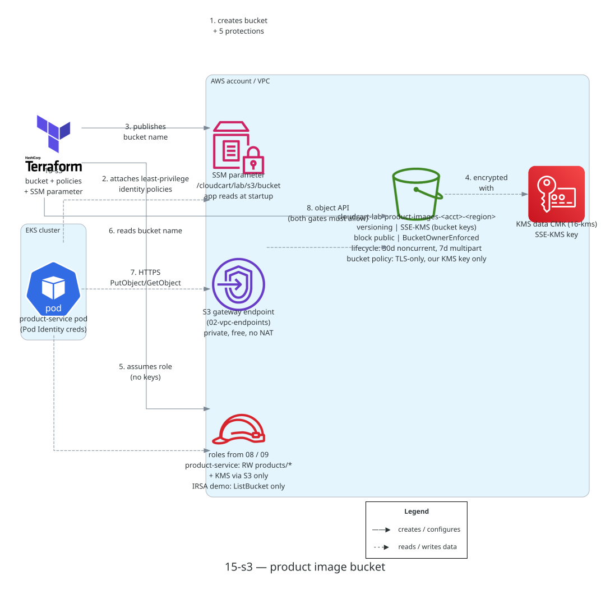

# 15-s3 — product image bucket

## 1. Purpose
This folder creates the **S3 bucket that stores product images** — versioned, encrypted with the data CMK, public access fully blocked — and attaches **least-privilege identity policies** to the product-service role (08-pod-identity) and the IRSA demo role (09-irsa) so pods can reach it without access keys. It also publishes the bucket name to Parameter Store so the application learns it at runtime instead of from YAML. S3 is object storage over HTTP APIs — not a filesystem.

## 2. Architecture Diagram

Solid arrows provision; dashed arrows carry credentials or HTTPS object traffic. Pod traffic to S3 flows through the **gateway VPC endpoint** (02-vpc-endpoints) — it never touches the NAT gateway.

## 3. Files Explained
| File | What it does | Why it exists |
|---|---|---|
| `versions.tf` / `providers.tf` | Standard pins (TF >= 1.11, AWS ~> 6.0), empty `backend "s3" {}` injected by `scripts/tf.sh`, cost-allocation tags. | Same boilerplate as every folder; state lands at `lab/15-s3/terraform.tfstate`. |
| `common.tf` | Shared naming/tags; `local.ssm_prefix` = `/cloudcart/lab`. | Generated from `_common`; two environments can never collide. |
| `data.tf` | Reads remote state of `16-kms`, `08-pod-identity`, `09-irsa`. | Imports `data_key_arn`, `role_names["product-service"]`, `irsa_demo_role_name`. |
| `variables.tf` | `force_destroy` (default `true`). | LAB convenience: lets `terraform destroy` empty the bucket. Set `false` in production. |
| `main.tf` | Bucket + 5 hardening configs, bucket policy, two identity policies, one SSM parameter. | The actual infrastructure; every resource carries WHY/DEPENDS/GOES-WRONG comments. |
| `outputs.tf` | Exports `bucket_name` and `bucket_arn`. | Read by scripts/humans; no Terraform folder consumes them (the app uses the SSM parameter). |
| `diagrams/` | `architecture.svg` + the Python script that regenerates it. | The picture above. |

## 4. How It Works
1. `scripts/tf.sh 15-s3 apply` injects the S3 backend config, and Terraform reads the state of `16-kms` (data key ARN), `08-pod-identity` (product-service role name) and `09-irsa` (IRSA demo role name).
2. The **bucket** `cloudcart-lab-product-images-<account>-<region>` is created with five protections: **versioning** (recover overwrites/deletes), **SSE-KMS with the data CMK** and `bucket_key_enabled` (cuts KMS API calls up to ~99%), **public access fully blocked**, **BucketOwnerEnforced ownership** (ACLs disabled — only policies matter), and a **lifecycle rule** expiring non-current versions after 30 days and aborting incomplete multipart uploads after 7 days.
3. A **bucket policy** adds a resource-based gate: deny all non-TLS traffic, and deny `PutObject` unless the request specifies our exact KMS key. Identity policy and bucket policy must **both** allow — the classic double-gate.
4. An **inline policy** is attached to the product-service role: `ListBucket` on the bucket, `GetObject`/`PutObject` only under `products/*`, and `kms:GenerateDataKey`/`kms:Decrypt` on the data key **constrained with `kms:ViaService`** so the key is usable only through S3. The IRSA demo role gets `ListBucket` only — enough to prove the web-identity flow without data access.
5. The bucket name is **published to Parameter Store** at `/cloudcart/lab/s3/bucket` (type String) — the app reads it at startup (see 18-parameter-store).
6. At **runtime**: the product-service pod gets temporary credentials via Pod Identity, resolves S3 through the **gateway VPC endpoint** (free, private — no NAT), and PutObject/GetObject calls pass both gates. Cost: **~$0.023/GB-month** + requests.

## 5. Dependencies and Outputs
- **Needs first:** `16-kms` (`data_key_arn`), `08-pod-identity` (`role_names["product-service"]`), `09-irsa` (`irsa_demo_role_name`) — all read via `terraform_remote_state` in `data.tf`. Runtime traffic rides the S3 gateway endpoint from `02-vpc-endpoints`.
- **Creates:** the bucket + versioning/encryption/public-access-block/ownership/lifecycle configs, the bucket policy, two inline role policies, and the `/cloudcart/lab/s3/bucket` SSM parameter.
- **Consumed by:** no Terraform folder reads this state (verified: `15-s3` appears elsewhere only in comments). Runtime consumers: product-service pods (via the SSM parameter + identity policy), and the IRSA demo in `kubernetes/serviceaccounts/irsa-demo.yaml`.
- **Verified from code:** the three remote-state reads (`data.tf`), every resource (`main.tf`), both outputs (`outputs.tf`), and the existence of `role_names` / `irsa_demo_role_name` outputs in 08/09.
- **Uncertain:** whether the bucket is currently applied in the AWS account (not checked, per safety rules).

## 6. How to Verify
`scripts/verify.sh` has **no automated verifier for 15-s3** — use these read-only checks:

| Command | Success means |
|---|---|
| `aws s3api head-bucket --bucket cloudcart-lab-product-images-<account>-<region>` | bucket exists and is yours |
| `aws s3api get-bucket-versioning --bucket <name> --query Status` | `Enabled` |
| `aws s3api get-bucket-encryption --bucket <name>` | `aws:kms` with the data key ARN, `BucketKeyEnabled=true` |
| `aws iam get-role-policy --role-name <product-service-role> s3-product-images` | policy scopes to `products/*` + KMS via S3 |
| `aws ssm get-parameter --name /cloudcart/lab/s3/bucket --query Parameter.Value` | equals the bucket name |

End-to-end proof: from a product-service pod, `boto3.client('s3').list_objects_v2(Bucket=...)` succeeds with Pod Identity credentials and no access keys.

## 7. Common Failure
- **`AccessDenied` on PutObject despite S3 rights** — the double gate: the role also needs `kms:GenerateDataKey` on the data key (SSE-KMS), and the bucket policy denies uploads naming any other key. `aws cloudtrail lookup-events` shows which side denied.
- **`AccessDenied` before any permission check (IRSA demo)** — the web-identity token's `sub` does not match the role trust policy, so `AssumeRoleWithWebIdentity` fails before the policy is evaluated. Compare the ServiceAccount annotation with the role ARN.
- **Bucket emptied by `terraform destroy`** — `force_destroy=true` (lab default) deletes every object **and every version**. Set `force_destroy=false` or snapshot/export images before destroying.

**Cleanup warning (destructive):** `force_destroy` makes destroy wipe all product images and their versions. Destroy in reverse dependency order with `scripts/destroy-all.sh`.

## 8. Interview Answer
**30-second answer:** "Product images live in a versioned, KMS-encrypted S3 bucket with public access fully blocked and ACLs disabled. Pods don't carry keys: the product-service role gets credentials through EKS Pod Identity, and this folder attaches the least-privilege policy — list the bucket, read/write only under products/, and use the KMS key only through S3 via kms:ViaService. A bucket policy adds a second gate: TLS only, and uploads must name our key. The bucket name reaches the app through Parameter Store, and traffic stays private through the S3 gateway endpoint — it never crosses the NAT."

**Likely follow-up — "Why AccessDenied when the role already has s3:PutObject?"** Because SSE-KMS adds a second authorization: the caller needs both the S3 action **and** KMS permissions (`GenerateDataKey` to write, `Decrypt` to read) on the bucket's key. Missing KMS rights is the classic silent failure — CloudTrail's event shows whether the denial came from the identity policy, the key policy, or the bucket policy.

*Lab vs production: force_destroy=true -> false + MFA delete / object lock where required · no replication -> cross-region replication for DR · endpoint-agnostic policy -> bucket policy restricted to the VPC endpoint.*
