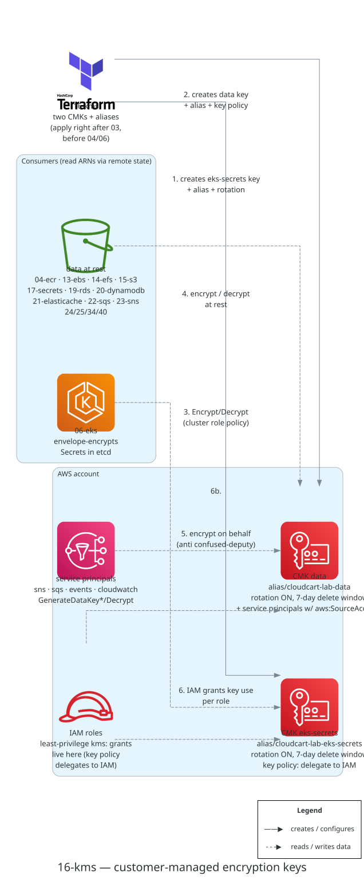

# 16-kms — customer-managed encryption keys

## 1. Purpose
This folder creates the **two customer-managed KMS keys** (CMKs) the whole project encrypts with: `eks-secrets`, used only by the EKS control plane to envelope-encrypt Kubernetes Secrets in etcd, and `data`, used for application data at rest (S3, SQS, SNS, DynamoDB, RDS, ElastiCache, EBS/EFS, Secrets Manager). Despite the number, it is applied **right after 03-security-groups** — folders numbered below it (04-ecr, 06-eks) already read its outputs.

## 2. Architecture Diagram

Solid arrows provision; dashed arrows are encrypt/decrypt data flows. Nothing calls these keys directly by name — consumers read the ARNs from this folder's remote state and IAM grants the per-role permissions.

## 3. Files Explained
| File | What it does | Why it exists |
|---|---|---|
| `versions.tf` / `providers.tf` | Standard pins (TF >= 1.11, AWS ~> 6.0), empty `backend "s3" {}` injected by `scripts/tf.sh`, cost-allocation tags. | Same boilerplate as every folder; state lands at `lab/16-kms/terraform.tfstate`. |
| `common.tf` | Shared naming/tags: aliases `alias/cloudcart-lab-eks-secrets`, `alias/cloudcart-lab-data`. | Generated from `_common`; two environments can never collide. |
| `main.tf` | The two `aws_kms_key` resources, their key policies, and two aliases. | The actual infrastructure; header comments explain the apply-order exception and the key-policy delegation model. |
| `variables.tf` | `deletion_window_in_days` (default 7, validated 7–30). | LAB=7 days; PRODUCTION=30. The window is the only undo for scheduled key deletion. |
| `outputs.tf` | Exports `eks_secrets_key_arn`, `data_key_arn`, `data_key_id`, `data_key_alias`. | Read by ~15 downstream folders via remote state. |
| `diagrams/` | `architecture.svg` + the Python script that regenerates it. | The picture above. |

**No `data.tf`:** this folder reads no other folder's state — it needs only the S3 backend from `00-bootstrap`.

## 4. How It Works
1. `scripts/tf.sh 16-kms apply` injects the S3 backend config. There are no upstream remote-state reads — only `00-bootstrap` must exist. It is applied right after `03-security-groups` and before `04-ecr`/`06-eks`; `scripts/tf.sh` refuses to run a folder whose upstream state is missing, so a wrong order fails fast.
2. A base **key policy** (`EnableIAMPolicies`) delegates authorization to IAM: the account root may `kms:*`, which really means "IAM policies on roles in this account may grant key use". Without this statement, IAM policies alone are useless against the key.
3. The **`eks-secrets` key** gets only that base policy. `06-eks` uses it for Secrets envelope encryption: each Secret is encrypted in etcd with a data key wrapped by this CMK, so reading etcd storage without `kms:Decrypt` is useless. The cluster role's permission is added by `06-eks` itself (inline policy).
4. The **`data` key** gets the base policy **plus** a service-principal statement: `sns`, `sqs`, `events` and `cloudwatch` may `GenerateDataKey*`/`Decrypt` — required for SNS→SQS fan-out into encrypted queues and CloudWatch alarms publishing to encrypted topics — conditioned on `aws:SourceAccount` = this account, which blocks the confused-deputy attack (another account's service using our key).
5. Both keys have **`enable_key_rotation = true`** (automatic yearly rotation of the backing key material) and a **deletion window** of 7 days (variable, 7–30). Aliases give humans and policies stable names; the key id is never hard-coded.
6. Cost: **$1/key/month** (prorated) + **$0.03 per 10,000 requests**. Two keys, two blast radii: disabling `eks-secrets` breaks the cluster; disabling `data` breaks the app data.

## 5. Dependencies and Outputs
- **Needs first:** nothing except the `00-bootstrap` state bucket. No `terraform_remote_state` reads (no `data.tf` exists).
- **Creates:** two CMKs with rotation + deletion window, two key policies, two aliases.
- **Consumed by (verified remote-state reads):** `eks_secrets_key_arn` → `06-eks`; `data_key_arn` → `04-ecr`, `13-ebs`, `14-efs`, `15-s3`, `17-secrets-manager`, `19-rds`, `20-dynamodb`, `21-elasticache`, `22-sqs`, `23-sns`, `24-eventbridge`, `25-lambda`, `34-cloudwatch`, `40-backup`. `data_key_id` / `data_key_alias` → scripts/humans.
- **Verified from code:** every consumer's `data.tf` lists `16-kms`; both keys, policies and aliases are in `main.tf`; all four outputs are in `outputs.tf`.
- **Uncertain:** whether the keys are currently applied in the AWS account (not checked, per safety rules). The comment in `main.tf` says the cluster role's key permission is "granted in 05" — in the current code it is granted by an inline policy in `06-eks/main.tf`; the comment is stale.

## 6. How to Verify
`scripts/verify.sh 16-kms` runs these read-only checks:

| Command | Success means |
|---|---|
| `aws kms describe-key --key-id alias/cloudcart-lab-data --query KeyMetadata.KeyState` | `Enabled` (also run for `alias/cloudcart-lab-eks-secrets`) |
| `aws kms get-key-rotation-status --key-id alias/cloudcart-lab-data --query KeyRotationEnabled` | `True` for both aliases |
| `aws kms describe-key --key-id alias/cloudcart-lab-data --query KeyMetadata.KeyManager` | `CUSTOMER` — a CMK we own, not an AWS-managed key |
| `aws kms get-key-policy --key-id alias/cloudcart-lab-data --policy-name default` | shows the delegate-to-IAM statement + the four service principals |

## 7. Common Failure
- **`AccessDenied` on `kms:Decrypt`** — the key policy delegation is fine but the caller's own IAM policy lacks the action, or a `kms:ViaService` condition does not match the calling service (see 15-s3). Confirm which side denied with `aws cloudtrail lookup-events`.
- **Cluster broken after the eks-secrets key is disabled** — the API server can no longer decrypt Secrets; pods may still run but Secret reads fail cluster-wide. Re-enable the key immediately; prevention: never disable keys casually, keep the deletion window.
- **Everything encrypted becomes unreadable** — the key was scheduled for deletion and the 7-day window elapsed. During the window, cancel with `aws kms cancel-key-deletion`; after it, the data is unrecoverable — restore from backups.

**Cleanup warning (destructive):** destroying this folder schedules deletion of both keys — after the window, all data encrypted with them (state bucket contents are SSE-S3, but EBS/EFS/S3/RDS/DynamoDB/SQS/SNS/etcd Secrets are not) is permanently unreadable. Destroy this folder **last**.

## 8. Interview Answer
**30-second answer:** "I use two customer-managed KMS keys with yearly automatic rotation: one exclusively for EKS Secrets envelope encryption — so etcd at rest is useless without kms:Decrypt — and one shared data key for S3, RDS, DynamoDB, queues and the rest, so I can audit and revoke access to all application data from one place. The key policy is the root of trust: it delegates to IAM, which is where least-privilege lives on the consuming roles, and the data key additionally allows service principals like SNS and EventBridge conditioned on our account id to stop confused-deputy use. Deletion is never instant — a 7-to-30-day window is the only undo."

**Likely follow-up — "Key policy vs IAM policy?"** For CMKs both gates apply: the **key policy** (resource-based, mandatory — every CMK must have one) defines who *can* be allowed, and **IAM policies** on roles define who *is* allowed. The standard pattern used here is a key policy that says "IAM policies in this account decide", then per-role grants; without that statement the account admin cannot even delegate, and with it you keep one auditable resource policy plus fine-grained identity policies.

*Lab vs production: one shared data key -> key per data domain for tighter blast radius · 7-day deletion window -> 30 days · single-region keys -> multi-region keys for DR · no usage alarms -> CloudWatch alarms on key usage anomalies.*
