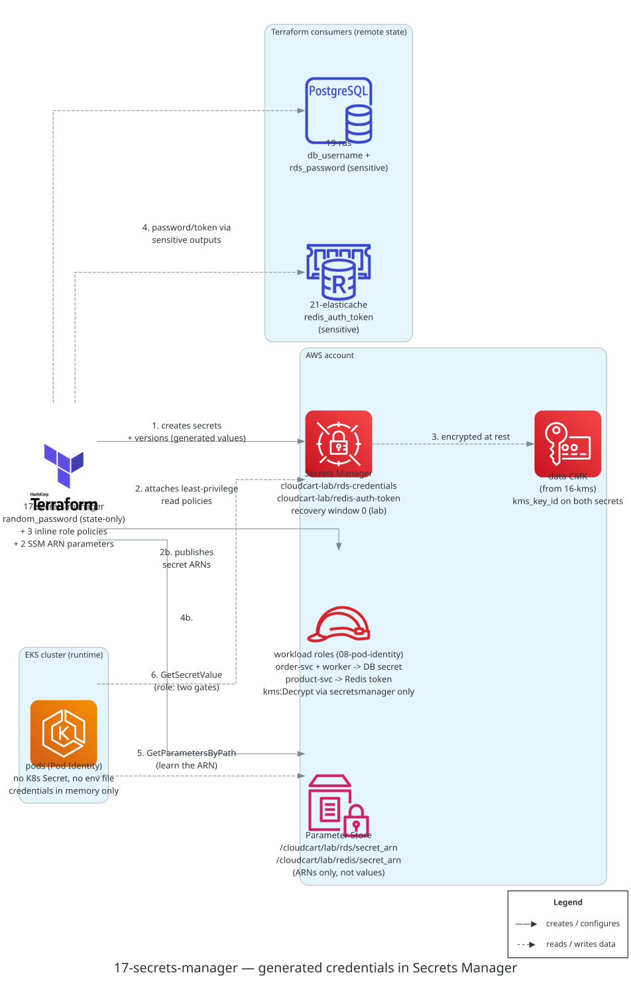

# 17-secrets-manager — database and cache credentials (no passwords in Git, YAML or images)

## 1. Purpose
This folder **generates** the RDS master password and the ElastiCache Redis AUTH token with Terraform's `random_password`, stores them in **AWS Secrets Manager** encrypted with the `data` CMK from `16-kms`, and grants each workload role read access to **only the secret it needs**. No human ever types, commits or sees these values: they travel through Terraform state (encrypted S3) into `19-rds`/`21-elasticache`, and pods fetch them at runtime with their Pod Identity role.

## 2. Architecture Diagram

Solid arrows provision; dashed arrows are data/identity flows. Runtime reads are direct API calls from the pods — there is no Kubernetes Secret, no CSI sync and no env-file anywhere in the repo (`kubernetes/secrets/` intentionally contains only a README).

## 3. Files Explained
| File | What it does | Why it exists |
|---|---|---|
| `versions.tf` / `providers.tf` | Standard pins (TF >= 1.11, AWS ~> 6.0), empty `backend "s3" {}` injected by `scripts/tf.sh`, cost-allocation tags. | Same boilerplate as every folder; state lands at `lab/17-secrets-manager/terraform.tfstate`. |
| `common.tf` | Shared naming/tags; `local.ssm_prefix` = `/cloudcart/lab`. | Generated from `_common`; two environments can never collide. |
| `data.tf` | Reads remote state of `16-kms` (`data_key_arn`) and `08-pod-identity` (`role_names`). | The encryption key and the roles to grant live upstream. |
| `variables.tf` | `db_username` (default `cloudcart_admin`), `recovery_window_in_days` (default 0; validated: 0 or 7–30). | The username is not secret; the window is the only undo for a deleted secret. |
| `main.tf` | Two `random_password`, two secrets + versions, three inline role policies, two SSM parameters. | The actual infrastructure; every block carries WHY/DEPENDS/GOES WRONG comments. |
| `outputs.tf` | `rds_secret_arn`, `redis_secret_arn`, `db_username`, plus **sensitive** `rds_password` / `redis_auth_token`. | `19-rds` and `21-elasticache` read them through remote state. |
| `diagrams/` | `architecture.svg` + the Python script that regenerates it. | The picture above. |

## 4. How It Works
1. `scripts/tf.sh 17-secrets-manager apply` injects the S3 backend and verifies upstream state exists. Two `terraform_remote_state` reads: `16-kms` for `data_key_arn`, `08-pod-identity` for the three workload role names (`product-service`, `order-service`, `worker` — the frontend has no AWS role by design).
2. `random_password.rds` (32 chars) and `random_password.redis` (40 chars) are generated with `special = false`, so the values are safe in any DSN/URL and every client library.
3. Two secrets are created — `cloudcart-lab/rds-credentials` and `cloudcart-lab/redis-auth-token` — both encrypted with the `data` CMK (`kms_key_id = local.data_key_arn`) and with `recovery_window_in_days = 0` in the lab, so destroy/apply cycles never hit "scheduled for deletion" (production: 7–30).
4. `aws_secretsmanager_secret_version` stores JSON: `{username, password}` for RDS, `{auth_token}` for Redis. Names and ARNs are in code; **the values exist only in Terraform state and in AWS**.
5. Least-privilege inline policies: **order-service + worker** get `secretsmanager:GetSecretValue` on only the RDS secret ARN (`read-rds-secret`); **product-service** gets it on only the Redis token (`read-redis-secret`). Both policies add `kms:Decrypt` on the data key conditioned on `kms:ViaService = secretsmanager.<region>.amazonaws.com` — the key is usable **only through Secrets Manager**, so two gates must pass.
6. Two plain SSM parameters publish the secret **ARNs** (not values): `/cloudcart/lab/rds/secret_arn` and `/cloudcart/lab/redis/secret_arn`.
7. Runtime: a pod loads the SSM prefix (`settings.py`, `GetParametersByPath`), learns the ARN, then calls `secretsmanager:GetSecretValue` with its Pod Identity credentials and keeps the value in memory — verified in `application/services/{order-service,product-service,worker}/app/`.
8. Cost: **$0.40/secret/month** + $0.05 per 10k API calls. **No rotation is configured** — the file header documents the production alternatives (`manage_master_user_password` on RDS, or a Lambda rotator).

## 5. Dependencies and Outputs
- **Needs first:** `00-bootstrap` (backend), `16-kms` and `08-pod-identity` — both read via `terraform_remote_state` in `data.tf`.
- **Creates:** 2 secrets + 2 versions, 3 inline role policies, 2 SSM parameters, 2 generated passwords (state-only).
- **Consumed by (verified remote-state reads):** `19-rds` (`db_username`, `rds_password` — `19-rds/main.tf` lines 65–66), `21-elasticache` (`redis_auth_token` — `21-elasticache/main.tf` line 54). At runtime the apps discover the ARNs via the SSM parameters, not via Terraform outputs.
- **Verified from code:** every resource in `main.tf`, both remote-state reads in `data.tf`, both consumers' `main.tf`, the runtime flow in `application/services/*/app/{settings,main}.py`, and `kubernetes/secrets/README.md` (no Kubernetes Secrets anywhere).
- **Uncertain:** whether the folder is currently applied in the AWS account (not checked, per safety rules). The old README said `rds_secret_arn`/`redis_secret_arn` outputs are read by "scripts/humans" — no script in the repo reads them; the apps use the SSM parameters instead.

## 6. How to Verify
`scripts/verify.sh` has **no verifier for this folder** — run these read-only checks manually. Never print secret **values**.

| Command | Success means |
|---|---|
| `aws secretsmanager list-secrets --query 'SecretList[].Name'` | exactly `cloudcart-lab/rds-credentials` and `cloudcart-lab/redis-auth-token` |
| `aws secretsmanager describe-secret --secret-id cloudcart-lab/rds-credentials --query 'KmsKeyId'` | the `data` CMK ARN — our key, not the AWS-managed default |
| `aws ssm get-parameter --name /cloudcart/lab/rds/secret_arn --query 'Parameter.Value' --output text` | the secret ARN the pods will ask for (an ARN is not sensitive) |
| `kubectl -n cloudcart exec deploy/order-service -- python -c "import boto3;boto3.client('secretsmanager').get_secret_value(SecretId='<arn>')['Name']"` | prints the secret **name** — exit 0 means both IAM and KMS gates passed; the same call from the frontend pod fails (it has no role) |

A clean `scripts/tf.sh 17-secrets-manager plan` on a fresh account shows **11 to add** (2 passwords + 2 secrets + 2 versions + 3 policies + 2 parameters).

## 7. Common Failure
- **`AccessDenied` on `GetSecretValue`** — there are two gates: the role needs `secretsmanager:GetSecretValue` on the exact secret ARN **and** `kms:Decrypt` on the data key with the `kms:ViaService` condition matching. Identify the pod's role (ServiceAccount → Pod Identity association) and use `aws cloudtrail lookup-events` to see which side denied.
- **`InvalidRequestException: ... scheduled for deletion`** on re-apply — a previous destroy left the secret in its recovery window. Restore it (`aws secretsmanager restore-secret`) or wait; the lab avoids this entirely with `recovery_window_in_days = 0`.
- **Next plan wants to overwrite a rotated value** — someone rotated the password outside Terraform; re-applying would re-store the old value and break RDS/ElastiCache auth. Let Terraform own the value, or import the rotated one.

**Cleanup warning (destructive):** with the lab window of 0, destroy deletes both secrets **immediately**. Destroy only after `19-rds` and `21-elasticache` are gone (reverse order, `scripts/destroy-all.sh`).

## 8. Interview Answer
**30-second answer:** "Terraform generates the database password and Redis token with `random_password` and stores them in Secrets Manager, encrypted with our customer-managed KMS key — nothing sensitive is in Git, images, Helm values or Kubernetes Secrets. Pods authenticate with EKS Pod Identity and call `GetSecretValue` at startup, learning which ARN to read from a non-secret Parameter Store entry. IAM is least-privilege per workload: order-service and worker can read only the DB secret, product-service only the Redis token, and decryption is pinned to the Secrets Manager service with `kms:ViaService`, so a stolen role cannot decrypt the key's other ciphertexts directly."

**Likely follow-up — "Kubernetes Secret vs Secrets Manager vs Parameter Store?"** "A Kubernetes Secret is base64 in etcd — encrypted at rest only if you wire envelope encryption — readable by anyone with `get secret`, copied into pod env/files, with no rotation and no per-read audit; CloudCart uses none. Parameter Store is hierarchical **configuration**: free standard tier, versioned, optional SecureString, but no native rotation. Secrets Manager is for real secrets: rotation support, per-read CloudTrail auditing, cross-account sharing — at $0.40/secret/month. Rule: config in Parameter Store, credentials in Secrets Manager, nothing sensitive in etcd."

*Lab vs production: generated password in Terraform state -> RDS `manage_master_user_password` or Lambda-driven rotation · recovery window 0 -> 7–30 days · no rotation -> `aws_secretsmanager_secret_rotation` · no read alarms -> CloudTrail/GuardDuty anomaly detection on `GetSecretValue`.*
