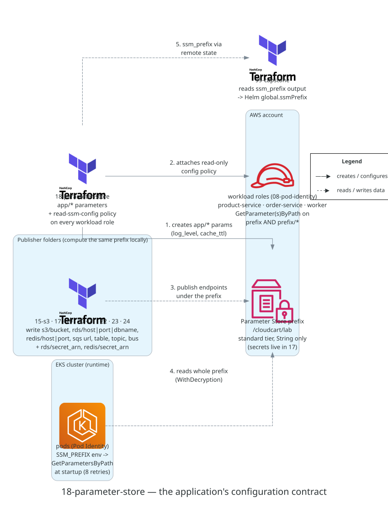

# 18-parameter-store — the application's configuration contract

## 1. Purpose
This folder defines the **shared Parameter Store contract** the whole project relies on: the prefix `/cloudcart/<env>`, a small set of shared non-secret app parameters, and a read-only IAM policy on every workload role. Other folders publish their endpoints under the same prefix (`15-s3` → `s3/bucket`, `19-rds` → `rds/host`, …), so pods read one path at startup and manifests/images contain **zero** environment-specific values.

## 2. Architecture Diagram

Solid arrows provision; dashed arrows are data/identity flows. The prefix is a **convention**: every folder computes it from its own `common.tf` (`/${project}/${environment}`), which is why publisher folders never read this folder's state.

## 3. Files Explained
| File | What it does | Why it exists |
|---|---|---|
| `versions.tf` / `providers.tf` | Standard pins (TF >= 1.11, AWS ~> 6.0), empty `backend "s3" {}` injected by `scripts/tf.sh`, cost-allocation tags. | Same boilerplate as every folder; state lands at `lab/18-parameter-store/terraform.tfstate`. |
| `common.tf` | `local.ssm_prefix` = `/cloudcart/lab`; the identical local exists in **every** folder. | The prefix is deterministic, so publishers need no remote state to write under it. |
| `data.tf` | Reads `08-pod-identity` remote state (`role_names`); computes `ssm_prefix_arn`. | The roles to grant; the prefix ARN is needed in the policy's `resources`. |
| `variables.tf` | `app_parameters` map — default `app/log_level=INFO`, `app/cache_ttl_seconds=60`. | One place to add shared non-secret settings; the variable description forbids secrets here. |
| `main.tf` | One `aws_ssm_parameter` per map entry + the `read-ssm-config` policy on every workload role. | The actual infrastructure; header comment explains the contract and the `prefix` + `prefix/*` gotcha. |
| `outputs.tf` | `ssm_prefix`, `ssm_prefix_arn`. | Read by `99-capstone`, which injects it as Helm value `global.ssmPrefix`. |
| `diagrams/` | `architecture.svg` + the Python script that regenerates it. | The picture above. |

## 4. How It Works
1. `scripts/tf.sh 18-parameter-store apply` injects the S3 backend and verifies `08-pod-identity` state exists. One remote-state read: the three workload role names (`product-service`, `order-service`, `worker`).
2. `aws_ssm_parameter.app` creates the shared settings — in the lab: `/cloudcart/lab/app/log_level = INFO` and `/cloudcart/lab/app/cache_ttl_seconds = 60`. Type `String`, **standard tier: free**, 10,000 parameters per account; no SecureString here by design — real secrets live in `17-secrets-manager`.
3. `ssm_prefix_arn` is computed as `arn:aws:ssm:<region>:<account>:parameter/cloudcart/lab`. The policy grants `ssm:GetParameter`, `ssm:GetParameters` and `ssm:GetParametersByPath` on **both** the prefix ARN and `prefix/*` — the classic gotcha: reading a path recursively needs the parent resource too.
4. The `read-ssm-config` inline policy attaches to **every** workload role (`for_each = local.role_names`) — read-only; no workload may write configuration.
5. Publisher folders write their endpoints under the same prefix from their own `common.tf` local (verified): `15-s3` → `s3/bucket`, `17` → `rds/secret_arn` + `redis/secret_arn`, `19-rds` → `rds/host|port|dbname`, `20-dynamodb` → `dynamodb/table_name`, `21-elasticache` → `redis/host|port`, `22-sqs` → `sqs/orders_queue_url`, `23-sns` → `sns/topic_arn`, `24-eventbridge` → `events/bus_name`.
6. Runtime: pods get the `SSM_PREFIX` env var (ConfigMap `cloudcart-config` in `kubernetes/config/`, or Helm value `global.ssmPrefix`); `settings.py` paginates `GetParametersByPath(Recursive=True, WithDecryption=True)` with 8 retry attempts and exponential backoff, then the app requires keys like `rds/secret_arn` (verified in `application/services/*/app/settings.py`).
7. `99-capstone` reads the `ssm_prefix` output via remote state and renders it into the Helm release — the same chart then runs in any environment with only the prefix differing.

## 5. Dependencies and Outputs
- **Needs first:** `00-bootstrap` (backend) and `08-pod-identity` — the only `terraform_remote_state` read (`data.tf`).
- **Creates:** the `app/*` parameters (2 by default) and 3 inline `read-ssm-config` role policies.
- **Consumed by (verified remote-state reads):** `99-capstone` reads `ssm_prefix` (`99-capstone/data.tf`, used in `main.tf` line 55). At runtime, `product-service`, `order-service` and `worker` read the whole prefix; publisher folders write under it without reading this folder's state.
- **Verified from code:** resources in `main.tf`, the remote-state read in `data.tf`, publishers' `aws_ssm_parameter` resources in folders 15/17/19/20/21/22/23/24, the runtime loader in `application/services/*/app/settings.py`, and the capstone read in `99-capstone/data.tf`.
- **Uncertain:** the old README listed `ssm_prefix_arn` as consumed by "scripts/humans (Helm values)" — no script or Helm template reads the ARN output; the chart gets only the prefix string. Whether the folder is currently applied was not checked (per safety rules).

## 6. How to Verify
`scripts/verify.sh` has **no verifier for this folder** — run these read-only checks manually:

| Command | Success means |
|---|---|
| `aws ssm get-parameters-by-path --path /cloudcart/lab --recursive --query 'Parameters[].Name'` | `app/*` entries now; `s3/bucket`, `rds/*`, `redis/*`, `sqs/*`, `dynamodb/table_name`, `sns/topic_arn`, `events/bus_name` once the publisher folders are applied |
| `aws iam get-role-policy --role-name cloudcart-lab-order-service --policy-name read-ssm-config` | policy JSON lists the prefix ARN **and** `prefix/*` |
| `kubectl -n cloudcart logs deploy/product-service \| grep loaded` | `loaded N parameters from /cloudcart/lab` — the pod read the contract with its own role |

A clean `scripts/tf.sh 18-parameter-store plan` on a fresh account shows **5 to add** (2 parameters + 3 role policies).

## 7. Common Failure
- **`AccessDeniedException` on `GetParametersByPath`** — the policy covers only `prefix/*` or only the prefix; recursive reads need **both** resource ARNs (this folder grants both). Also check for a region/account typo in the computed ARN.
- **`ParameterNotFound` in the deploy script, or a pod crash "missing configuration key"** — the folder that owns that key was never applied, or published a different key name. List the path (command above) and compare with what the app requires.
- **Pod crash "could not load configuration from SSM prefix"** — `SSM_PREFIX` env var missing (ConfigMap not applied) or no parameters exist under the prefix yet; `settings.py` retries 8 times with backoff, then raises.

**Cleanup:** safe to destroy (parameters and policies only) — but every AWS-facing pod loses its config source until re-applied. Destroy in reverse dependency order (`scripts/destroy-all.sh`).

## 8. Interview Answer
**30-second answer:** "Parameter Store is the configuration contract between Terraform and the pods. Every infrastructure folder publishes its outputs — bucket name, RDS host, queue URL — under a shared `/cloudcart/<env>` prefix, and this folder defines the shared settings plus a read-only policy on each workload's Pod Identity role scoped to exactly that prefix and its children. At startup each service calls `GetParametersByPath`, so the same container image and the same Helm chart run in every environment — when RDS is recreated with a new hostname I re-apply Terraform and restart pods; no YAML edits, no image rebuilds. Secrets are deliberately excluded: credentials live in Secrets Manager, only their ARNs are parameters."

**Likely follow-up — "Why Parameter Store instead of ConfigMaps?"** "A ConfigMap would bake environment values into Kubernetes objects that someone must template per environment — exactly the coupling this avoids. With SSM, Terraform (the source of truth for infrastructure) publishes the values, IAM controls read access per workload, `WithDecryption` handles any SecureString transparently, and the read path is audited in CloudTrail. The trade-off is a runtime AWS dependency at pod startup, which the retry loop in the settings loader absorbs."

*Lab vs production: one shared prefix -> per-domain prefixes with per-service read scopes · String only -> SecureString for borderline values · no change control -> advanced tier + change approvals · no alarms -> alert on repeated config-load failures.*
